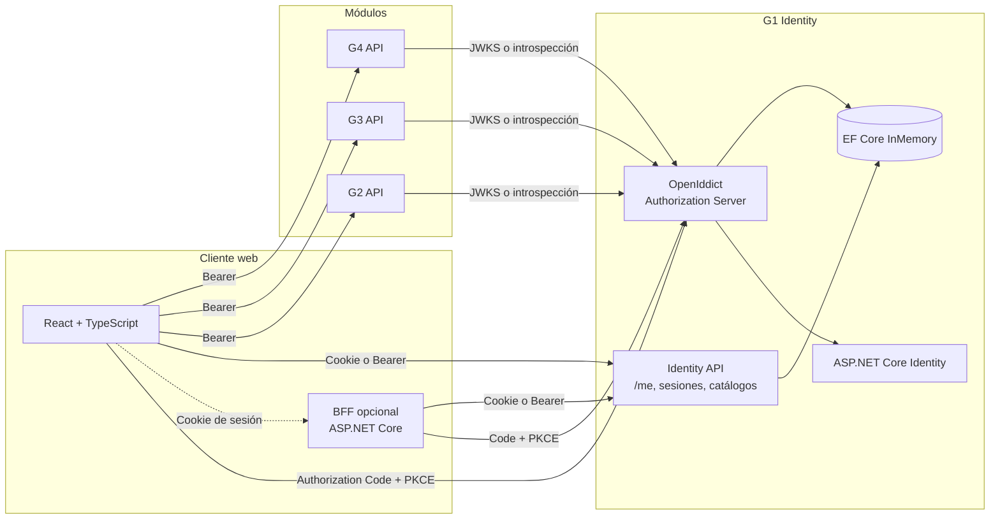
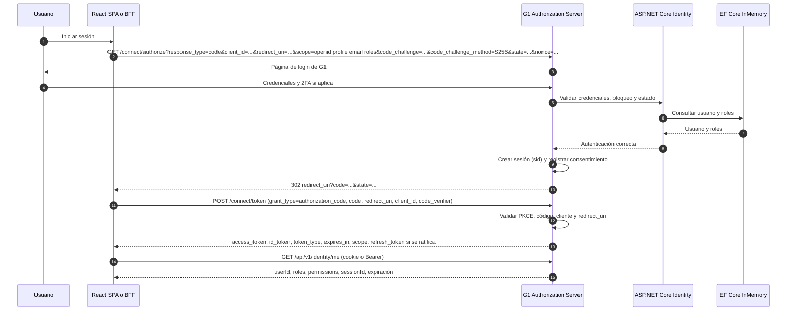

# Diagnóstico técnico de G1: identidad y autorización

- **Fecha**: 2026-11-11
- **Ámbito**: módulo G1 (Infraestructura) del Gestor del Club de Rugby
- **Estado**: diagnóstico para ratificación; no autoriza a implementar la aplicación
- **Documentos relacionados**: `specs/001-g1-identidad-contrato-mock/spec.md`, `docs/decisions/ADR-0001-servidor-oauth-propio-identity-openiddict.md`, `docs/decisions/ADR-0002-inmemory-persistencia-academica.md`, `docs/decisions/pending-decisions.md`

## 1. Resumen ejecutivo

La arquitectura propuesta es **viable** con el stack solicitado, pero con tres conclusiones que deben ratificarse antes de escribir código:

1. **El servidor OAuth 2.0/OIDC propio con ASP.NET Core Identity + OpenIddict 7.8.0 es compatible con .NET 10 y EF Core InMemory 10.0.15.** La combinación se compiló y ejecutó en un spike aislado; los stores de Identity y OpenIddict crean, revocan y borran entidades correctamente.
2. **OpenIddict con InMemory exige `DisableBulkOperations()`.** Sin esa opción, la revocación falla porque InMemory no soporta `ExecuteUpdate`/`ExecuteUpdateAsync`. Con la opción, la revocación y el borrado funcionan. Es una condición obligatoria, no una recomendación.
3. **InMemory no cumple la restricción técnica 4 de la constitución** (migraciones versionadas) ni el principio V (integridad y recuperación). Es aceptable solo como persistencia académica, con excepción formal y sin datos reales. La alternativa recomendada es SQLite o SQL Server/PostgreSQL antes de producción.

El primer entregable debe ser el **contrato OpenAPI 3.1 + mock de identidad**, no el servidor real. El mock debe reproducir Authorization Code + PKCE, JWKS, `/me`, sesiones, logout y errores, y debe ser sustituible por el servidor real sin cambiar el código de negocio de G2, G3 y G4.

## 2. Requisitos evaluados

- Servidor OAuth 2.0/OIDC propio, sin Google, Microsoft, GitHub, Auth0 ni proveedores externos.
- ASP.NET Core Identity para usuarios, contraseñas, roles, bloqueo y verificación.
- OpenIddict para OAuth 2.0/OIDC, tokens, descubrimiento, JWKS y revocación.
- Minimal APIs en .NET 10 y C# 14.
- EF Core InMemory para la persistencia académica.
- React + TypeScript como cliente web independiente.
- OpenAPI + Swagger UI.
- xUnit y Playwright.
- Authorization Code + PKCE; prohibidos implicit flow y password grant.
- Sin criptografía manual ni servidor OAuth casero.
- Registro, login, logout, emisión y validación de tokens, roles, permisos, sesiones y revocación.
- Primer entregable: contrato + mock para G2, G3 y G4.
- Decisiones de arquitectura y persistencia documentadas y pendientes de ratificación.
- Sin código de aplicación ni cambios en la constitución en esta fase.

## 3. Versiones verificadas

La verificación se realizó el 2026-11-11 consultando NuGet y ejecutando un spike aislado en `/tmp/opencode/g1-compat`. El spike no forma parte del repositorio.

| Componente | Versión | TFM o compatibilidad | Estado |
| --- | --- | --- | --- |
| .NET SDK | 10.0.404 | `net10.0` | Verificado en el entorno |
| C# | 14 | `net10.0` | Verificado por compilación |
| `Microsoft.AspNetCore.Identity.EntityFrameworkCore` | 10.0.15 | `net10.0` | Verificado |
| `Microsoft.EntityFrameworkCore.InMemory` | 10.0.15 | `net10.0` | Verificado |
| `OpenIddict.AspNetCore` | 7.8.0 | `net10.0` | Verificado |
| `OpenIddict.EntityFrameworkCore` | 7.8.0 | `net10.0` | Verificado |
| `Microsoft.EntityFrameworkCore.Relational` | 10.0.14 declarado por OpenIddict; resuelto a 10.0.15 | `net10.0` | Sin conflicto en el spike |
| `Microsoft.AspNetCore.OpenApi` | 10.0.15 | `net10.0` | OpenAPI 3.1 por defecto en .NET 10 |
| `Swashbuckle.AspNetCore.SwaggerUI` | 10.3.1 | `net10.0` | Solo UI; la generación la hace `Microsoft.AspNetCore.OpenApi` |
| `xunit.v3` | 4.0.3 | .NET 8 o superior | Versión actual; fijar en el plan |
| `Microsoft.Playwright` | 1.64.1 | .NET Standard 2.0 | Versión actual; fijar en el plan |

Notas:

- **OpenIddict 8.0 solo existe como preview** en la fecha de la decisión (`8.0.0-preview.*`). No se adopta para el alcance estable. Se usa 7.8.0.
- **OpenAPI 3.1** es el formato por defecto de `Microsoft.AspNetCore.OpenApi` en .NET 10. Swagger UI se añade con `Swashbuckle.AspNetCore.SwaggerUI`; no es necesario el paquete completo de Swashbuckle.
- **La skill interna prefiere Scalar** sobre Swagger UI, pero la constitución y el usuario exigen Swagger UI. Prevalece la constitución. La generación del documento queda desacoplada de la UI.
- **React y TypeScript**: la versión exacta se fijará en el plan del frontend; no se declara compatibilidad de versiones de React en este diagnóstico porque no se ha probado en esta sesión.

## 4. Compatibilidad y evidencia

### 4.1 Identity + EF Core InMemory

El spike creó un `DbContext` que hereda de `IdentityDbContext<IdentityUser>`, configuró `UseInMemoryDatabase` y `UseOpenIddict()`, y ejecutó:

- Creación del modelo y `EnsureCreatedAsync()`.
- Creación de un rol `Administrador`.
- Creación de un usuario con correo y contraseña.
- Asignación del rol al usuario.

Resultado: todas las operaciones devolvieron `Succeeded = true`. Identity funciona con InMemory para el alcance académico.

### 4.2 OpenIddict + EF Core InMemory

El spike creó una aplicación OpenIddict, una autorización, un token y ejecutó `RevokeBySubjectAsync`. El token pasó a estado `revoked`. Después borró la aplicación y comprobó que ya no se encontraba.

El punto crítico: **sin `DisableBulkOperations()` la revocación falla**. La excepción observada fue:

```text
System.InvalidOperationException: The methods 'ExecuteUpdate' and 'ExecuteUpdateAsync'
are not supported by the current database provider. Please contact the publisher of the
database provider for more information.
```

Con `DisableBulkOperations()` la revocación y el borrado funcionan. La explicación es que los stores de OpenIddict usan operaciones masivas de EF Core para revocar y limpiar tokens; InMemory no las soporta. La opción hace que OpenIddict use el camino compatible.

### 4.3 Resolución de dependencias

`OpenIddict.EntityFrameworkCore` 7.8.0 declara una dependencia de `Microsoft.EntityFrameworkCore.Relational` 10.0.14. Identity e InMemory se fijaron en 10.0.15. NuGet resolvió la versión superior sin conflicto y el spike compiló y ejecutó. No se observó un fallo de carga de ensamblados.

Esto no garantiza que cualquier combinación futura de versiones funcione. La recomendación es fijar las versiones con un archivo de dependencias centralizado y actualizar solo tras ejecutar la suite de compatibilidad.

### 4.4 Qué se ha verificado y qué no

| Área | Verificado | Evidencia |
| --- | --- | --- |
| Existencia y TFM de los paquetes | Sí | NuGet y compilación `net10.0` |
| Modelo de Identity + OpenIddict en InMemory | Sí | `EnsureCreatedAsync` y operaciones CRUD |
| Creación de usuario, rol y asignación | Sí | Resultados `Succeeded` |
| Creación de cliente, autorización y token | Sí | Stores de OpenIddict |
| Revocación por sujeto | Sí, con `DisableBulkOperations()` | Estado `revoked` |
| Borrado de cliente | Sí | Búsqueda posterior sin resultado |
| Flujo HTTP completo Authorization Code + PKCE | **No** | Pendiente de prueba en fase B |
| Firma y validación real de JWT con JWKS | **No** | Pendiente de prueba en fase B |
| Logout OIDC y revocación de sesión | **No** | Pendiente de prueba en fase B |
| Rotación y reutilización de refresh token | **No** | Pendiente de decisión D-004 |
| 2FA, correo y SMS | **No** | Fuera de la fase A |
| Rendimiento y concurrencia | **No** | InMemory no es representativo |
| Gestión de claves de producción | **No** | Fuera de la fase A |

La honestidad sobre esta tabla es importante: el spike demuestra compatibilidad de modelo y stores, no que el flujo OAuth completo esté probado. La fase B debe incluir una prueba de integración HTTP antes de declarar terminada la autenticación.

## 5. Arquitectura propuesta



Componentes:

- **Authorization Server**: OpenIddict sobre ASP.NET Core. Expone descubrimiento, JWKS, autorización, token, userinfo, revocación y logout. Valida PKCE y emite tokens asimétricos.
- **Identity**: usuarios, contraseñas, roles, bloqueo, verificación y 2FA. Identity no expone tokens por sí mismo; OpenIddict orquesta el protocolo.
- **Identity API**: contrato de negocio para G2/G3/G4. Devuelve la identidad efectiva, resúmenes mínimos, sesiones y catálogos. No duplica datos de otros módulos.
- **Persistencia**: EF Core InMemory para el alcance académico, con las limitaciones del ADR-0002.
- **Cliente web**: React + TypeScript. La decisión BFF vs SPA pública está pendiente (D-001); el contrato admite ambos.
- **Mock**: implementación de desarrollo del contrato, con personas ficticias y el mismo flujo OIDC. No es una vía de autorización alternativa.
- **Contrato**: OpenAPI 3.1 versionado, fuente de verdad para consumidores y pruebas.

### 5.1 Estructura de repositorio propuesta

La estructura definitiva se decidirá en el plan, pero la forma recomendada es:

```text
contracts/g1-identity/openapi.v1.yaml
src/G1.Identity.Mock/
src/G1.Identity.Api/            # fase B
src/G1.Identity.Contracts/      # solo si se necesita compartir DTOs; evitar acoplar
tests/G1.Identity.ContractTests/
tests/G1.Identity.E2E/
web/g1-identity-ui/             # fase B, React + TypeScript
docs/g1/
docs/decisions/
specs/001-g1-identidad-contrato-mock/
```

El contrato debe ser la fuente de verdad. Si el documento se genera desde código, CI debe comparar el documento generado con el contrato comprometido y fallar ante divergencias. Así se evita que el mock o el servidor real cambien la forma de la respuesta sin actualizar el contrato.

## 6. Flujos de identidad

### 6.1 Registro

1. El usuario accede al formulario de registro de G1 desde la web pública o la PWA.
2. Envía correo, teléfono, nombre visible, contraseña y aceptación de términos. Los campos exactos y el tratamiento de menores dependen de D-007.
3. G1 valida formato, unicidad de correo, política de contraseñas y consentimiento.
4. Identity crea el usuario con `EmailConfirmed = false` y `PhoneNumberConfirmed = false`. La contraseña se almacena con el hash con sal de Identity; no se guarda en claro.
5. G1 envía un código de verificación de correo y, si se ratifica, de teléfono. Los proveedores dependen de D-010.
6. El usuario verifica el correo y el teléfono. Hasta entonces, sus permisos son limitados y el contrato lo refleja en `/me`.
7. Un administrador asigna roles según la matriz aprobada. La asignación registra quién, a quién, cuándo y por qué.
8. El usuario inicia sesión por el flujo OIDC. No se emite ningún token durante el registro.

Puntos de seguridad:

- La respuesta de registro no debe revelar si un correo ya existe; se usa un mensaje genérico y verificación por correo.
- La contraseña nunca se registra en logs ni se devuelve en respuestas.
- Los datos de menores requieren consentimiento del tutor y visibilidad restringida.
- El registro no concede roles por defecto; la denegación es el estado inicial.

### 6.2 Login con Authorization Code + PKCE



Reglas:

- `response_type=code` es el único admitido.
- `code_challenge_method=S256` es obligatorio; `plain` se rechaza.
- `state` y `nonce` se validan en el cliente y en el servidor.
- `redirect_uri` debe coincidir exactamente con una URI registrada; no se admiten comodines.
- El código es de un solo uso y de vida corta (propuesta: 5 minutos).
- El canje exige el `code_verifier`; un verificador incorrecto devuelve `invalid_grant`.
- Si el cliente es confidencial, se autentica además con su secreto o certificado. Si es público, PKCE es la protección principal.
- No existe un endpoint de login que reciba usuario y contraseña y devuelva tokens. El formulario de login pertenece a la UI del servidor de autorización o al BFF y establece una cookie, no un token OAuth.

### 6.3 Emisión y validación de tokens

**Emisión**:

- OpenIddict firma los tokens con una clave asimétrica (RSA o ECDSA). En desarrollo se pueden usar claves efímeras; en producción se gestionan fuera del repositorio y se rotan.
- El token de acceso incluye `iss`, `aud`, `sub`, `client_id`, `scope`, `exp`, `iat`, `nbf`, `jti`, `sid`, roles y permisos efectivos. La inclusión de permisos en el token debe equilibrar tamaño y frescura; si la lista crece, se usa introspección o un claim compacto.
- El token de identidad incluye los claims OIDC necesarios (`sub`, `name`, `email`, `email_verified`, `nonce`, `auth_time`, `amr`, `sid`). No incluye datos sensibles innecesarios.
- El token de refresco, si se ratifica, es opaco o cifrado, de un solo uso y con rotación. La reutilización de un refresco revocado revoca la familia.
- Los tokens no se guardan en claro en logs ni en el repositorio.

**Validación en G2/G3/G4**:

1. Obtener y cachear el descubrimiento y JWKS de G1.
2. Validar firma, `iss`, `aud`, `exp`, `nbf` y algoritmo permitido; rechazar `alg=none` y `kid` desconocido.
3. Comprobar el `scope` y el permiso requerido para el recurso.
4. Comprobar que el `userId` del token coincide con el recurso y el ámbito; nunca confiar en un `userId` del cuerpo o la query.
5. Para operaciones de alto riesgo o revocación inmediata, consultar introspección (D-005).
6. Devolver `401` si la identidad falta o es inválida, y `403` si es válida pero no tiene permiso.

La validación local con JWKS es la opción por defecto por latencia y desacoplamiento. La introspección es la opción para revocación inmediata y para módulos que no pueden validar JWT. La decisión D-005 debe ratificar el equilibrio.

### 6.4 Roles y permisos

- **Roles**: agrupaciones estables como `club_admin`, `sports_manager`, `coach`, `player`, `member`, `tutor`, `kit_staff` y `communications_staff`. El catálogo definitivo es D-002.
- **Permisos**: códigos atómicos con espacio de nombres por módulo, por ejemplo `identity.users.summary.read`, `sports.attendance.manage`, `members.fees.read` o `communications.news.publish`.
- **Matriz rol-permiso**: deny-by-default. Un rol concede permisos explícitos; un permiso no listado se deniega.
- **Asignación**: cada asignación registra actor, objetivo, rol, ámbito opaco, fecha y motivo. Se puede revocar y queda auditada.
- **Ámbitos**: G1 no interpreta los ámbitos de negocio. Si un rol es de equipo, G2 resuelve el equipo con `userId` y sus propios datos. G1 puede transportar una referencia opaca, pero no la valida como regla de G2. D-003 queda cerrada para la fase A con este modelo (2026-11-24); la verificación con G2 corresponde a la fase C.
- **Tokens**: los permisos efectivos pueden viajar en el token para evitar una consulta por petición. Si el usuario pierde un rol, el token anterior sigue vigente hasta su expiración; la ventana debe documentarse o cubrirse con introspección.
- **Consumidores**: deben ignorar permisos desconocidos y no conceder por defecto. Un permiso nuevo no debe romper un cliente antiguo.
- **Contacto**: G1 solo expone el contacto del usuario autenticado en `/me` y `/connect/userinfo` (scope `email`); no hay endpoint de contacto de terceros ni directorio. G4 obtiene los contactos de G3 (D-017, 2026-11-24). Cualquier ampliación futura exige permiso, auditoría y consentimiento de tutor para menores.

### 6.5 Sesiones

- Cada autenticación crea una **sesión lógica** con `sessionId` opaco, usuario, cliente, fechas de creación, último uso y expiración, estado y métodos de autenticación.
- El `sessionId` se incluye en el claim `sid` del token de acceso y del token de identidad.
- La sesión tiene expiración por inactividad y expiración absoluta (D-004).
- El usuario puede listar sus sesiones y revocar una o todas. La sesión actual se marca con `current`.
- La lista no expone direcciones IP ni secretos; usa una etiqueta de dispositivo derivada del user agent, sanitizada.
- La sesión se revoca en logout, en revocación explícita y cuando el usuario se desactiva o cambia su contraseña, según la política que se ratifique.
- El registro de sesión y los tokens de OpenIddict se vinculan por `sid` y por la autorización; la implementación concreta se decidirá en el plan.

### 6.6 Logout y revocación

**Logout del usuario**:

1. El cliente llama a `POST /api/v1/identity/logout` con cookie o Bearer.
2. G1 marca la sesión como revocada, revoca los tokens asociados y registra el evento.
3. G1 invalida la cookie de sesión si existe.
4. El cliente completa el logout OIDC con `/connect/logout` e `id_token_hint`, `post_logout_redirect_uri` y `state` si quiere cerrar también la sesión del proveedor.
5. El usuario vuelve a la página de inicio de sesión o a la web pública.

**Revocación administrativa o del usuario**:

- Revocar una sesión invalida esa sesión y sus tokens.
- Revocar todas las sesiones invalida todas menos la actual si se solicita.
- Desactivar una cuenta invalida todas sus sesiones.
- Cambiar la contraseña puede invalidar todas las sesiones, según la política.
- La revocación es idempotente y no revela si la sesión ya estaba revocada.

**Propagación**:

- Un JWT stateless sigue siendo válido hasta su expiración. La revocación inmediata requiere introspección, denylist o tokens de referencia.
- La recomendación es JWT de corta duración, revocación de refresco e introspección para alto riesgo. La ventana objetivo es ≤ 5 minutos (D-005).
- La prueba de aceptación debe medir la ventana real y documentarla.

### 6.7 Refresco

- Si se ratifica, el refresco es rotativo: cada uso emite un refresco nuevo y marca el anterior como usado.
- La reutilización de un refresco ya usado revoca la familia y obliga a volver a autenticarse.
- El refresco se guarda de forma segura; en BFF, nunca llega al navegador.
- La duración, la rotación y la revocación dependen de D-004.
- Si no se ratifica el refresco, el usuario vuelve a autenticarse al expirar el acceso; la UX debe reflejarlo.

### 6.8 Segundo factor

- Identity soporta TOTP y códigos de recuperación; los proveedores de correo y SMS requieren configuración.
- La obligatoriedad para administradores, la opción para el resto y el step-up se deciden en D-006.
- El segundo factor no debe revelar si una cuenta existe.
- Los códigos de recuperación son de un solo uso y se muestran una sola vez.
- La UI debe ser accesible y permitir copiar o descargar los códigos de forma segura.

## 7. Contrato y mock

### 7.1 Estrategia de contrato

- **API-first**: el contrato OpenAPI 3.1 se define antes de implementar el mock y el servidor real.
- **Fuente de verdad**: el contrato versionado en `contracts/g1-identity/openapi.v1.yaml` (o la ubicación que apruebe el plan).
- **Generación**: si el documento se genera desde el código, CI compara el generado con el comprometido y falla ante divergencias.
- **Swagger UI**: se sirve en desarrollo y pruebas; en producción se deshabilita por defecto.
- **Versionado**: cambios aditivos en `v1`; cambios incompatibles en `v2` con nota de migración.
- **Errores**: RFC 9457 para la API de negocio y errores OAuth estándar para el protocolo.
- **Ejemplos**: cada operación incluye ejemplos de éxito y error con datos ficticios.

### 7.2 Estrategia del mock

El mock debe ser fiel al comportamiento observable, no una implementación de juguete:

- Implementa descubrimiento, JWKS, autorización, token, userinfo, revocación y logout.
- Solo admite Authorization Code + PKCE S256.
- Ofrece un selector de personas accesible y, solo en desarrollo, `mock_persona` para automatización.
- Emite JWT de desarrollo con claims completos y JWKS consultable.
- Permite simular caducidad, revocación, audiencia incorrecta y firma inválida.
- Publica personas y fixtures deterministas.
- Se deshabilita fuera de desarrollo y pruebas.
- No expone emisión directa de tokens ni contraseñas fijas en el código.
- Se sustituye por el servidor real cambiando configuración, no código de negocio.

El mock no es una vía de autorización. Los módulos no deben usarlo en producción ni confiar en sus atajos. La guía de consumo debe repetirlo.

### 7.3 Pruebas

- **Contrato**: cada operación documentada tiene al menos una prueba de éxito y una de error; las respuestas validan contra el esquema.
- **E2E**: Playwright recorre autorización, PKCE, `/me`, logout y revocación.
- **Sustitución**: una prueba de humo cambia el emisor del mock por una configuración equivalente y verifica que el consumidor no cambia.
- **Seguridad**: pruebas de token caducado, revocado, firma inválida, audiencia incorrecta, `alg=none`, redirect URI no registrada, PKCE incorrecto y reutilización de código.
- **Accesibilidad**: el selector de personas se prueba con teclado y con comprobaciones automáticas.

## 8. Persistencia y limitaciones de InMemory

InMemory es útil para el alcance académico, pero no es una base de datos de producción:

- Los datos se pierden al reiniciar.
- No hay migraciones versionadas.
- No hay claves externas, unicidad ni borrados en cascada.
- No hay transacciones ni concurrencia real.
- No hay copias de seguridad ni recuperación.
- Las operaciones masivas de OpenIddict no funcionan sin `DisableBulkOperations()`.
- Las consultas y el rendimiento no se parecen a los de una base relacional.
- El key ring de Data Protection se pierde si no se persiste; las cookies y tokens protegidos se invalidan.
- El rate limiting en memoria es por instancia; no sirve para un despliegue con varias instancias.

Estas limitaciones contradicen la restricción técnica 4 y el principio V. El ADR-0002 registra la excepción y exige ratificación. Si no se ratifica, la alternativa es SQLite o SQL Server/PostgreSQL antes de la fase B.

## 9. Cumplimiento de la constitución

| Principio o restricción | Cómo se cumple | Estado |
| --- | --- | --- |
| I. Fidelidad al dominio y control del alcance | G1 solo gestiona identidad; no invade datos de G2/G3/G4 | Diseño |
| II. Arquitectura modular e independiente | Contrato REST versionado; `userId` opaco; sin acceso directo a datos de otros módulos | Diseño |
| III. Desarrollo guiado por contratos | OpenAPI 3.1, Swagger UI, versionado y pruebas de contrato | Diseño |
| IV. Seguridad, privacidad e identidad única | Identity, OpenIddict, PKCE, sesiones revocables, deny-by-default, auditoría | Diseño; falta prueba HTTP |
| V. Integridad de datos y trazabilidad | Validación en dominio, auditoría y pruebas; InMemory no cumple copias ni migraciones | **Conflicto** con InMemory |
| VI. Experiencia por rol, accesibilidad e idioma | Contrato por rol, UI accesible, textos en castellano | Diseño |
| VII. Calidad comprobable y pruebas | xUnit, Playwright, pruebas de acceso permitido y denegado | Diseño |
| VIII. Simplicidad y mantenimiento | Bibliotecas estándar, sin criptografía manual; ADR | Diseño |
| IX. Requisitos confirmados frente a pendientes | Decisiones D-001 a D-015 registradas | Diseño |
| X. Integración progresiva con datos simulados | Mock fiel, sustituible y sin atajos | Diseño |
| Restricción 1: React + TypeScript | Cliente independiente | Diseño |
| Restricción 2: .NET 10 y Minimal APIs | TFM `net10.0`, C# 14 | Verificado |
| Restricción 3: OpenAPI + Swagger UI | `Microsoft.AspNetCore.OpenApi` + Swagger UI | Verificado |
| Restricción 4: migraciones | InMemory no las soporta | **Conflicto**; ADR-0002 |
| Restricción 7: xUnit y Playwright | xUnit v3 y Playwright | Verificado |
| Restricción 8: comunicaciones segmentables | G4 consume identidad y sus propios datos | Fuera de G1 |

## 10. Riesgos y mitigaciones

| Riesgo | Probabilidad | Impacto | Mitigación |
| --- | --- | --- | --- |
| El mock se desvía del servidor real | Media | Alto | Contrato único, pruebas de contrato y sustitución |
| InMemory oculta errores relacionales | Alta | Alto | Modelo agnóstico y CI con proveedor relacional |
| Revocación no inmediata con JWT | Alta | Medio | TTL corto, introspección para alto riesgo y ventana documentada |
| OpenIddict 8.0 preview inestable | Media | Medio | Usar 7.8.0 y revisar migración |
| Pérdida de claves o key ring | Media | Alto | Almacén de secretos y key ring persistente |
| Fuga de datos de menores o salud | Baja | Muy alto | Minimización, permisos específicos y pruebas de denegación |
| Mock expuesto en producción | Baja | Muy alto | Deshabilitado por entorno y revisión de configuración |
| Swagger UI expuesta en producción | Media | Medio | Deshabilitada por defecto y revisión |
| Consumidores copian roles del mock | Media | Alto | Catálogo versionado y revisión de código |
| Decisiones sin ratificar bloquean la fase B | Alta | Medio | Registro con responsable y fecha objetivo |
| Contrato sin gobierno | Media | Alto | Versionado, diff de OpenAPI y aviso a consumidores |

## 11. Decisiones pendientes

El registro completo está en `docs/decisions/pending-decisions.md`. Las que bloquean la fase B son:

- **D-001**: BFF con cookies o SPA pública con tokens.
- **D-004**: duración de tokens, refresco y sesión (valores de producción).
- **D-005**: estrategia de revocación.

D-002 y D-003 quedan cerradas para la fase A (catálogo provisional y resolución de ámbitos por el módulo propietario); la ratificación formal del catálogo y la verificación de ámbitos con G2 corresponden a fases posteriores. D-017 también queda cerrada para la fase A: G1 no expone contacto de terceros y G4 lo obtiene de G3; su integración depende del contrato de contacto de G3.

Las que bloquean producción son D-009 (persistencia), D-010 (correo/SMS), D-011 (alojamiento y claves), D-013 (eliminación y anonimización) y D-014 (deprecación).

## 12. Plan de entrega recomendado

### Fase 0: ratificación

- Aprobar `specs/001-g1-identidad-contrato-mock/spec.md`.
- Aprobar el ADR-0001 y el ADR-0002, o sustituir InMemory por SQLite.
- Ratificar D-001, D-004 y D-005 antes de la fase B; D-002 y D-003 quedan aprobadas para la fase A, con su validación formal pendiente.
- Confirmar el catálogo mínimo de roles y permisos con G2, G3 y G4.

### Fase A: contrato y mock

- Crear el contrato OpenAPI 3.1.
- Implementar el mock con personas, PKCE, JWKS, `/me`, sesiones, logout y errores.
- Crear Swagger UI y la guía de consumo.
- Añadir pruebas de contrato, E2E y accesibilidad.
- Publicar el contrato y avisar a los consumidores.

### Fase B: servidor real

- Implementar Identity + OpenIddict + InMemory.
- Implementar registro, login, verificación, recuperación, 2FA y sesiones.
- Implementar emisión, validación, revocación y refresco.
- Probar el flujo HTTP completo, JWT, JWKS, logout y revocación.
- Sustituir el mock por el servidor real en un entorno de integración.

### Fase C: integración y producción

- Integrar G2, G3 y G4 con permisos reales.
- Ejecutar E2E de roles y escenarios de denegación.
- Cambiar InMemory por un proveedor relacional con migraciones.
- Revisar seguridad, RGPD, claves, copias y observabilidad.
- Desplegar con Swagger UI deshabilitada y claves fuera del repositorio.

### Puertas de calidad

- No se implementa la fase B sin contrato aprobado.
- No se usa el mock en producción.
- No se usan datos reales con InMemory.
- No se declara terminada la autenticación sin prueba HTTP completa.
- No se acepta un cambio incompatible sin versión y plan de migración.
- No se acepta una entrega con secretos, datos personales en logs o pruebas de denegación ausentes.

## 13. Qué no se ha verificado

- El flujo HTTP completo de Authorization Code + PKCE.
- La firma y validación real de JWT con JWKS.
- El logout OIDC y la revocación de sesión de extremo a extremo.
- La rotación y reutilización de refresh token.
- 2FA, correo y SMS.
- La concurrencia y el rendimiento con InMemory.
- La gestión de claves y el key ring en producción.
- Las versiones exactas de React, TypeScript y Node.js.
- La integración real con G2, G3 y G4.

Estas verificaciones son condiciones de la fase B, no de la fase A. El contrato y el mock pueden empezar sin ellas, pero no pueden declararse integración real.

## 14. Recomendación

1. **Aprobar la especificación 001 y los ADR-0001 y ADR-0002**, o cambiar InMemory por SQLite si se exige cumplir la restricción de migraciones.
2. **Ratificar D-001 a D-005** antes de implementar el servidor real.
3. **Implementar primero el contrato y el mock**, con OpenAPI 3.1, Swagger UI, Authorization Code + PKCE, personas ficticias y pruebas de contrato.
4. **No implementar la fase B** hasta completar la prueba HTTP, la gestión de claves y la revisión de seguridad.
5. **No usar InMemory con datos reales** ni declarar que cumple migraciones.

La solución es técnicamente viable y está alineada con la constitución, salvo la excepción de persistencia, que debe ratificarse de forma explícita. El mayor riesgo no es la compatibilidad de las bibliotecas, sino la falsa confianza que produciría un mock o un InMemory que se parezcan a producción sin serlo.

## 15. Referencias

- `specs/001-g1-identidad-contrato-mock/spec.md`
- `docs/decisions/ADR-0001-servidor-oauth-propio-identity-openiddict.md`
- `docs/decisions/ADR-0002-inmemory-persistencia-academica.md`
- `docs/decisions/pending-decisions.md`
- [OpenIddict documentation](https://documentation.openiddict.com/)
- [OpenIddict Entity Framework Core integration](https://documentation.openiddict.com/integrations/entity-framework-core)
- [OpenIddict Proof Key for Code Exchange](https://documentation.openiddict.com/configuration/proof-key-for-code-exchange)
- [ASP.NET Core Identity documentation](https://learn.microsoft.com/aspnet/core/security/authentication/identity)
- [ASP.NET Core OpenAPI in .NET 10](https://learn.microsoft.com/aspnet/core/fundamentals/openapi/aspnetcore-openapi?view=aspnetcore-10.0)
- [EF Core In-Memory Database Provider](https://learn.microsoft.com/ef/core/providers/in-memory/)
- [RFC 6749: The OAuth 2.0 Authorization Framework](https://www.rfc-editor.org/rfc/rfc6749)
- [RFC 7636: Proof Key for Code Exchange](https://www.rfc-editor.org/rfc/rfc7636)
- [RFC 7009: OAuth 2.0 Token Revocation](https://www.rfc-editor.org/rfc/rfc7009)
- [RFC 7662: OAuth 2.0 Token Introspection](https://www.rfc-editor.org/rfc/rfc7662)
- [RFC 9457: Problem Details for HTTP APIs](https://www.rfc-editor.org/rfc/rfc9457)
- [OpenID Connect Core 1.0](https://openid.net/specs/openid-connect-core-1_0.html)
