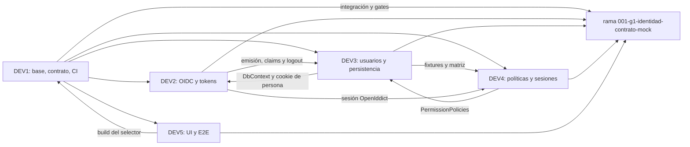

# Reparto de trabajo G1 — fase A

- **Fecha**: 2026-11-24
- **Equipo**: G1 Infraestructura, cinco integrantes (DEV1–DEV5)
- **Ámbito**: contrato OpenAPI 3.1 + mock de identidad + Swagger UI + pruebas de contrato/E2E
- **Listado ejecutable**: [`specs/001-g1-identidad-contrato-mock/tasks.md`](../../specs/001-g1-identidad-contrato-mock/tasks.md)
- **Especificación**: [`specs/001-g1-identidad-contrato-mock/spec.md`](../../specs/001-g1-identidad-contrato-mock/spec.md)
- **Plan**: [`specs/001-g1-identidad-contrato-mock/plan.md`](../../specs/001-g1-identidad-contrato-mock/plan.md)
- **Incorporación**: [`team-onboarding.md`](./team-onboarding.md)

Este documento es la fuente de verdad del reparto, las ramas, la propiedad de archivos y los entregables. Las tareas se numeran de T001 a T072 y **pertenecen solo a la fase A**. El reparto previsto de las fases B y C está separado al final y no debe ejecutarse aquí.

## 1. Puertas de entrada (antes de tocar código)

1. **ADR-0002 ratificada por equipo G1 el 2026-11-25** como excepción académica, siguiendo las indicaciones del profesor. EF Core InMemory se conserva con `DisableBulkOperations()`, pero la constitución exige migraciones versionadas: la excepción no cubre datos reales ni producción y no modifica `.specify/memory/constitution.md`. La Phase 2 puede ejecutarse en este alcance; la persistencia relacional sigue pendiente.
2. ADR-0001 está propuesta: bloquea la arquitectura de la fase B, no el mock de fase A con OpenIddict como motor temporal.
3. D-001, D-012 y D-016 quedan abiertas. El contrato admite cookie y Bearer, declara el consentimiento como simulación configurable y marca `aud=identity-api` como provisional para access tokens; el ID token usa `aud=client_id`. Nadie debe resolver estas decisiones en código.
4. Las skills de `.github/skills/` se conservan sin cambios. GitHub Copilot las descubre por su `name`/`description`; OpenCode las descubre desde `opencode.jsonc` (`"skills": ["./.github/skills"]`), comprobado cargando `dotnet-api-architecture`.

## 2. Modelo de ramas e integración

- **Rama base de trabajo**: `001-g1-identidad-contrato-mock` (rama de integración de la fase A).
- **Ramas individuales de larga duración**: `dev1/infra-contract`, `dev2/oauth-oidc`, `dev3/users-persistence`, `dev4/authz-audit`, `dev5/ui-e2e`.
- Cada rama se crea desde la rama de integración con `git switch -c <rama> origin/001-g1-identidad-contrato-mock` tras un `git fetch`. Si la rama de integración aún no existe en `origin`, se crea localmente desde `main` y se publica una sola vez.
- **Flujo**: rama DEV → commit → PR a `001-g1-identidad-contrato-mock` → revisión por el propietario de archivo → merge → actualización de la rama DEV desde la integración.
- **Prohibido**: push directo a `main` o a la rama de integración; merge de PR sin pruebas; editar archivos de otro DEV sin coordinación previa.
- **Convención de commits y PR**: Conventional Commits, según `.github/instructions/wow-conventional-commits.instructions.md`.
- El contrato `contracts/openapi.v1.yaml` es inmutable salvo PR de DEV1 con aviso a G2, G3 y G4.

## 3. Reparto de la fase A

### DEV1 — Arquitectura, infraestructura, contrato, Swagger, CI e integración

- **Rama**: `dev1/infra-contract`
- **Tareas**: T001, T002, T003, T005, T006, T007, T008, T009, T013, T014, T019, T020, T021, T022, T023, T024, T030, T056, T059, T064, T065
- **Prioridades**: P0 de Setup/Foundational, P1 de US1, P2/P3 de cierre
- **Archivos afectados**:
  - `G1.Identity.slnx`, `global.json`, `Directory.Packages.props`, `.github/workflows/ci-g1-identity.yml`
  - `src/G1.Identity.Mock/G1.Identity.Mock.csproj`, `Program.cs`, `BuilderExtensions.cs`, `AppExtensions.cs`, `Settings/`, `Constants.cs`, `OpenApi/`, `Endpoints/DocsEndpoints.cs`, `Resources/`
  - `src/G1.Identity.Mock/wwwroot/` (build del selector servido en T030), `appsettings*.json`, `Properties/launchSettings.json`
  - `specs/001-g1-identidad-contrato-mock/contracts/`, `scripts/export-openapi.sh`, `scripts/check-openapi-breaking.sh`
  - `docs/g1/herramientas-y-skills.md`, `docs/g1/validacion-fase-a.md`
  - `tests/G1.Identity.ContractTests/OpenApiDocumentTests.cs`, `SwaggerAvailabilityTests.cs`
- **Dependencias**: ninguna para Setup; integra los PR de DEV2–DEV5; T064 y T065 dependen de todas las tareas.
- **Entregables**: solución y CI en verde; contrato validado con `@redocly/cli` y sin rupturas `oasdiff`; Swagger UI solo en `Development`/`Testing`; evidencia de skills en OpenCode/Copilot; validación final SC-001 a SC-012.
- **Pruebas y documentación propias**: T019, T020, T056, T059, T064, T065, además de la revisión de exactitud contractual de T058 y T063.

### DEV2 — Autenticación, OAuth/OIDC, emisión y validación de tokens

- **Rama**: `dev2/oauth-oidc`
- **Tareas**: T015, T025, T026, T027, T028, T031, T032, T043, T049, T067
- **Prioridades**: P0 de Foundational, P1 de US2, P2 de sesión/casos límite
- **Archivos afectados**:
  - `src/G1.Identity.Mock/Auth/OpenIddictConfiguration.cs`, `Auth/ClaimsTransformation.cs`
  - `src/G1.Identity.Mock/Endpoints/OidcEndpoints.cs` (incluye `/connect/logout` en T043)
  - `src/G1.Identity.Mock/Fixtures/MockClients.cs`, `Fixtures/EdgeCaseTokens.cs`
  - `tests/G1.Identity.ContractTests/PkceFlowTests.cs`, `TokenValidationTests.cs`, `TokenAudienceTests.cs`
- **Dependencias**: T001, T002, T009, T014 (DEV1); T010 y T016 (DEV3) para la autenticación de persona y el DbContext.
- **Entregables**: solo `authorization_code` + `refresh_token` con PKCE S256; descubrimiento, JWKS, token, userinfo y revocación delegados a OpenIddict; access token con `aud=identity-api` e ID token con `aud=client_id`; refresh rotativo y casos `token.*` sin vía alternativa de emisión.
- **Pruebas y documentación propias**: T025, T026, T032, T067; comentarios XML de claims y nota de audiencia por tipo de token en `contracts/README.md` revisada con DEV1.

### DEV3 — Gestión de usuarios, registro/preparación, perfiles y persistencia

- **Rama**: `dev3/users-persistence`
- **Tareas**: T010, T011, T012, T016, T017, T036, T037, T047, T048, T050, T051, T055, T071
- **Prioridades**: P0 de Foundational, P1 de US3, P2 de US5, P3 de compatibilidad
- **Archivos afectados**:
  - `src/G1.Identity.Mock/Persistence/G1IdentityDbContext.cs`, `Persistence/Entities/`
  - `src/G1.Identity.Mock/Auth/MockPersonaAuthentication.cs`
  - `src/G1.Identity.Mock/Fixtures/SeedData.cs` (15 personas + 4 casos de token)
  - `src/G1.Identity.Mock/Endpoints/IdentityEndpoints.cs` (T036 y T037, secuenciales), `Endpoints/MockPersonaEndpoints.cs`
  - `tests/G1.Identity.ContractTests/MockFixturesTests.cs`, `ContactIsolationTests.cs`
  - `tests/G1.Identity.CompatibilityTests/ProviderSmokeTests.cs`
- **Dependencias**: T001, T002, T009, T013, T014 (DEV1); T035 (DEV4) para la política de permisos en T037; T028 (DEV2) para tokens en `/me`.
- **Entregables**: InMemory con `DisableBulkOperations()` y sin migraciones; 15 personas ficticias, 10 roles, 3 permisos de G1 y matriz deny-by-default; reset sin token y solo en Development/Testing; minimización de menores y sin contacto de terceros.
- **Pruebas y documentación propias**: T047, T051, T055, T071; invariantes de entidades documentados en `data-model.md` y revisados con DEV1.
- **Nota**: el registro real, la verificación y la recuperación pertenecen a la fase B; en fase A solo se modela su preparación, no se implementan.

### DEV4 — Autorización, roles, permisos, políticas y auditoría

- **Rama**: `dev4/authz-audit`
- **Tareas**: T018, T033, T034, T035, T038, T039, T040, T041, T042, T044, T045, T046, T052, T060, T066, T068, T069
- **Prioridades**: P0 de Foundational, P1 de US3, P2 de US4/cierre, P3 de matriz
- **Archivos afectados**:
  - `src/G1.Identity.Mock/Endpoints/ErrorMapping.cs`, `Endpoints/CatalogEndpoints.cs`, `Endpoints/SessionEndpoints.cs` (T042 y T044, secuenciales)
  - `src/G1.Identity.Mock/Auth/PermissionPolicies.cs`, `Abstractions/ISessionService.cs`, `Services/SessionService.cs`, `Services/AuditService.cs`
  - `tests/G1.Identity.ContractTests/AuthorizationTests.cs`, `InvalidTokenTests.cs`, `CatalogTests.cs`, `SessionTests.cs`, `AuditTests.cs`, `SecurityHeadersAndSecretScanTests.cs`, `README.md`
- **Dependencias**: T001, T002, T009, T013, T014 (DEV1); T017 (DEV3) para la matriz; T028 y T043 (DEV2) para sesión y logout OIDC.
- **Entregables**: denegación por defecto y códigos desconocidos no concedidos; catálogos versionados con `provisional: true`; revocación de sesión/refresh con `keepCurrentSession`; auditoría sin secretos ni datos personales; errores RFC 9457 y OAuth estándar separados.
- **Pruebas y documentación propias**: T033, T034, T039, T046, T052, T060, T066, T068, T069; matriz de cobertura en `tests/G1.Identity.ContractTests/README.md`.

### DEV5 — Frontend React, accesibilidad, E2E y documentación de consumo

- **Rama**: `dev5/ui-e2e`
- **Tareas**: T004, T029, T053, T054, T057, T058, T061, T062, T063, T070, T072
- **Prioridades**: P1 de US2, P2 de guía/calidad, P3 de E2E
- **Archivos afectados**:
  - `src/G1.Identity.Mock.Ui/` completo (`package.json`, `package-lock.json`, `tsconfig.json`, `vite.config.ts`, `src/components/PersonaSelector.tsx`, `src/App.tsx`, `src/styles/tokens.css`)
  - `tests/G1.Identity.E2E/AuthorizationFlowSpecs.cs`, `AccessibilitySpecs.cs`, `TokenStorageSpecs.cs`
  - `tests/G1.Identity.ContractTests/ProviderSubstitutionTests.cs`, `PerformanceTests.cs`
  - `docs/g1/guia-consumo-identidad.md`, `docs/g1/CHANGELOG-contrato.md`
- **Dependencias**: T001, T002, T005 (DEV1); T016 (DEV3) y T028/T031 (DEV2) para el flujo E2E; T030 (DEV1) para servir el build.
- **Entregables**: selector accesible WCAG 2.1 AA sin tokens en el navegador; E2E en Chromium y navegador adicional programado; guía de consumo completa; CHANGELOG `1.0.0`; prueba de sustitución por configuración.
- **Pruebas y documentación propias**: T053, T054, T057, T058, T061, T062, T063, T070, T072. DEV1 revisa la exactitud contractual de T058 y T063.

## 4. Propiedad de archivos y prevención de conflictos

| Archivo o carpeta | Propietario | Regla |
| --- | --- | --- |
| `G1.Identity.slnx`, `global.json`, `Directory.Packages.props` | DEV1 | Solo DEV1 edita; los demás solicitan paquetes por PR |
| `.github/workflows/`, `scripts/` | DEV1 | Gate de CI y exportación del contrato |
| `Program.cs`, `BuilderExtensions.cs`, `AppExtensions.cs`, `Settings/`, `OpenApi/`, `Constants.cs`, `Resources/` | DEV1 | Pipeline y documento OpenAPI |
| `contracts/openapi.v1.yaml`, `contracts/README.md` | DEV1 | Cambio incompatible exige `v2`, nota de migración y aviso |
| `Auth/OpenIddictConfiguration.cs`, `Auth/ClaimsTransformation.cs`, `Endpoints/OidcEndpoints.cs`, `Fixtures/MockClients.cs`, `Fixtures/EdgeCaseTokens.cs` | DEV2 | Incluye logout OIDC |
| `Auth/MockPersonaAuthentication.cs`, `Persistence/`, `Fixtures/SeedData.cs`, `Endpoints/IdentityEndpoints.cs`, `Endpoints/MockPersonaEndpoints.cs` | DEV3 | `IdentityEndpoints.cs`: T036 antes que T037 |
| `Auth/PermissionPolicies.cs`, `Endpoints/CatalogEndpoints.cs`, `Endpoints/SessionEndpoints.cs`, `Services/`, `Abstractions/ISessionService.cs`, `Endpoints/ErrorMapping.cs` | DEV4 | `SessionEndpoints.cs`: T042 antes que T044 |
| `src/G1.Identity.Mock.Ui/`, `tests/G1.Identity.E2E/` | DEV5 | `wwwroot/` pertenece a DEV1; publicación en T030 |
| `tests/G1.Identity.ContractTests/` | Un archivo por responsable | DEV1 (documento), DEV2 (token), DEV3 (fixtures/contacto), DEV4 (autorización/seguridad), DEV5 (sustitución/perf) |
| `spec.md`, `plan.md`, `tasks.md`, `quickstart.md`, `data-model.md` | DEV1 con aportaciones de todos | Cambios de spec antes que de código; ningún cambio simule ratificaciones |

Si dos integrantes necesitan el mismo archivo, se crea un archivo nuevo con interfaces y se coordinan en un PR conjunto. Ningún `[P]` de `tasks.md` comparte archivo con otro `[P]`.

## 5. Grafo de dependencias entre responsables

## 6. Criterios de aceptación del reparto

- Cada tarea T001–T072 tiene un único responsable DEV1–DEV5 y una prioridad P0–P3.
- El marcador `[P]` solo aparece cuando los archivos son distintos y no hay dependencias pendientes.
- Cada tarea lleva asociado un archivo concreto, un entregable verificable y sus propias pruebas/documentación.
- No existen tareas de fase B/C mezcladas con la fase A.
- No se edita la constitución. ADR-0002 queda registrada como ratificada solo para el alcance académico (equipo G1, 2026-11-25).
- Las 19 operaciones del contrato y los SC-001 a SC-012 están trazados en `tasks.md` y `quickstart.md`.

---

## 7. Reparto previsto para fases posteriores (informativo, NO ejecutable)

Estas filas son una **previsión de responsabilidades**. No generan tareas en `tasks.md`, no deben marcarse como completadas y exigirán su propia especificación, plan y listado aprobados.

### Fase B — Servidor OAuth real

| Responsable previsto | Responsabilidad prevista | Decisiones que deben cerrarse antes |
| --- | --- | --- |
| DEV1 | Arquitectura del servidor real, despliegue, CI/CD, contrato `v2` si procede | ADR-0001 ratificada; contrato v1 estable |
| DEV2 | ASP.NET Core Identity + OpenIddict: login, emisión, refresco, logout y gestión de claves | D-001, D-004 (producción), D-005, D-016 |
| DEV3 | Registro, verificación de correo/teléfono, recuperación, 2FA y persistencia real | D-007, D-010, D-011; persistencia relacional pendiente (ADR-0002 solo cubre el alcance académico) |
| DEV4 | Catálogo definitivo, asignación auditada, políticas y retención de auditoría | D-002 (ratificación), D-006, D-008, D-013 |
| DEV5 | Cliente web definitivo (BFF o SPA), E2E de producción y accesibilidad | D-001 y D-016 |

### Fase C — Integración real con G2, G3 y G4

| Responsable previsto | Responsabilidad prevista | Decisiones que deben cerrarse antes |
| --- | --- | --- |
| DEV1 | Coordinación de integración, versionado y gates entre módulos | Fase B completa |
| DEV2 | Validación de tokens y audiencias en G2, G3 y G4 | D-016 |
| DEV3 | Contrato de contacto de G3 para G4 y verificación de datos propios | D-017 y acuerdo G3-G4 |
| DEV4 | Verificación de ámbitos y denegación con entrenadores de uno y varios equipos | D-003 con G2 |
| DEV5 | E2E cruzada G2/G3/G4, accesibilidad y sustitución final del mock | Módulos en entorno de integración |

La fase B no puede empezar sin ADR-0001 y las decisiones de producción ratificadas. La fase C no puede empezar sin la fase B y sin los contratos entre módulos acordados.
