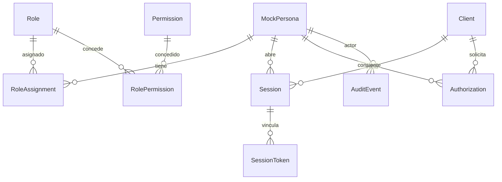

# Data Model: identidad y mock (fase A)

**Feature**: `001-g1-identidad-contrato-mock` | **Fecha**: 2026-11-24

Modelo de datos del mock de identidad. No es el modelo definitivo de producción: describe las entidades necesarias para que el contrato sea ejecutable y verificable en la fase A. El modelo es agnóstico del proveedor y se implementa con EF Core InMemory según ADR-0002, **ratificado por equipo G1 el 2026-11-25 como excepción académica**; la excepción no cubre datos reales ni producción y la persistencia relacional sigue pendiente en D-009.

Convenciones generales:

- Identificadores opacos con prefijo legible: `usr_`, `ses_`, `rol_`, `prm_`, `cli_`, `aud_`.
- Fechas ISO 8601 en UTC con sufijo `Z`; en persistencia, `DateTimeOffset` UTC.
- Códigos de rol y permiso estables y en inglés; etiquetas y descripciones en castellano.
- Denegación por defecto: un permiso no concedido explícitamente se deniega.
- Sin secretos, contraseñas fijas ni datos personales reales en fixtures.

## 1. Entidades

### 1.1 MockPersona

Identidad ficticia que representa a un usuario del club en el mock.

| Campo | Tipo | Obligatorio | Reglas |
| --- | --- | --- | --- |
| `key` | string | Sí | Clave estable del fixture, única; usada por `mock_persona` y pruebas. |
| `userId` | string | Sí | Opaco, único, estable, prefijo `usr_`, no secuencial. |
| `displayName` | string | Sí | Nombre visible ficticio; no contiene datos reales. |
| `email` | string | Sí | Correo ficticio válido; único. |
| `emailVerified` | boolean | Sí | Estado de verificación. |
| `phone` | string | No | Teléfono ficticio; no se expone a terceros (D-017). |
| `phoneVerified` | boolean | Sí | Estado de verificación del teléfono. |
| `status` | enum | Sí | `active`, `inactive`, `locked`. |
| `isMinor` | boolean | Sí | Activa la minimización adicional en resúmenes. |
| `authenticationMethods` | string[] | Sí | Métodos usados en el fixture (`pwd`, `mock_persona`). |
| `labels` | string[] | No | Etiquetas de caso (`minor`, `unverified`, `expired-token`, etc.). |
| `fixtureVersion` | string | Sí | Versión del conjunto de fixtures; se publica en la API de mock. |

**Relaciones**: 1-N con `RoleAssignment` y `Session`; 1-N con `Authorization` y `AuditEvent` como actor u objetivo.

**Invariantes**:

- `key` y `userId` son únicos.
- Un `userId` no cambia entre reinicios ni entre resets.
- `email` y `phone` nunca se exponen en el resumen de otro usuario.
- Una persona `inactive` o `locked` no puede completar la autorización; el error es genérico.

### 1.2 Role

Rol del catálogo provisional v1.

| Campo | Tipo | Obligatorio | Reglas |
| --- | --- | --- | --- |
| `code` | string | Sí | Único, estable, inglés, `snake_case`. |
| `label` | string | Sí | Castellano. |
| `description` | string | Sí | Castellano; no promete permisos de otros módulos. |
| `assignable` | boolean | Sí | Indica si puede asignarse en la administración futura. |
| `catalogVersion` | string | Sí | Versión del catálogo. |

**Catálogo v1 (10 roles)**: `club_admin`, `sports_manager`, `coach`, `player`, `tutor`, `member`, `sponsor`, `supporter`, `kit_staff`, `communications_staff`.

### 1.3 Permission

Permiso atómico propiedad de G1.

| Campo | Tipo | Obligatorio | Reglas |
| --- | --- | --- | --- |
| `code` | string | Sí | Único, estable, inglés, con espacio de nombres. |
| `label` | string | Sí | Castellano. |
| `ownerModule` | string | Sí | `G1` en v1. |
| `description` | string | Sí | Castellano. |
| `catalogVersion` | string | Sí | Versión del catálogo. |

**Permisos v1**: `identity.users.summary.read`, `identity.users.lookup`, `identity.admin`.

Los permisos de G2, G3 y G4 no se definen aquí; cada módulo los publicará y G1 los incorporará de forma aditiva.

### 1.4 RolePermission

Matriz explícita rol-permiso.

| Campo | Tipo | Obligatorio | Reglas |
| --- | --- | --- | --- |
| `roleCode` | string | Sí | FK lógica a `Role.code`. |
| `permissionCode` | string | Sí | FK lógica a `Permission.code`. |
| `granted` | boolean | Sí | En v1 solo se almacenan concesiones; la ausencia deniega. |

**Invariante**: la matriz publicada coincide exactamente con la tabla de la especificación (5.5). Cualquier permiso no listado se deniega.

| Rol | `identity.users.summary.read` | `identity.users.lookup` | `identity.admin` |
| --- | --- | --- | --- |
| `club_admin` | Sí | Sí | Sí |
| `sports_manager` | Sí | Sí | No |
| `coach` | No | No | No |
| `player` | No | No | No |
| `tutor` | No | No | No |
| `member` | No | No | No |
| `sponsor` | No | No | No |
| `supporter` | No | No | No |
| `kit_staff` | No | No | No |
| `communications_staff` | No | Sí | No |

### 1.5 RoleAssignment

Asignación auditada de un rol a una persona.

| Campo | Tipo | Obligatorio | Reglas |
| --- | --- | --- | --- |
| `assignmentId` | string | Sí | Opaco, prefijo `asg_`. |
| `userId` | string | Sí | FK lógica a `MockPersona.userId`. |
| `roleCode` | string | Sí | FK lógica a `Role.code`. |
| `scopeRef` | string? | No | Referencia opaca de ámbito; G1 no la interpreta (D-003). |
| `grantedBy` | string | Sí | `userId` del actor o `system` en fixtures. |
| `grantedAt` | datetime | Sí | UTC. |
| `reason` | string | Sí | Motivo legible; sin datos sensibles. |
| `revokedAt` | datetime? | No | Si existe, la asignación no concede permisos. |

**Invariantes**:

- Una asignación revocada no contribuye a `roles` ni a `permissions`.
- `scopeRef` se transporta sin validación de negocio; el módulo propietario lo resuelve.
- Toda asignación y revocación genera un `AuditEvent`.

### 1.6 Session

Periodo de autenticación de una persona.

| Campo | Tipo | Obligatorio | Reglas |
| --- | --- | --- | --- |
| `sessionId` | string | Sí | Opaco, prefijo `ses_`, único; claim `sid`. |
| `userId` | string | Sí | FK lógica a `MockPersona.userId`. |
| `clientId` | string | Sí | Cliente OAuth que inició la sesión. |
| `createdAt` | datetime | Sí | UTC. |
| `lastSeenAt` | datetime | Sí | UTC; se actualiza con actividad autenticada. |
| `expiresAt` | datetime | Sí | Expiración por inactividad (30 min por defecto). |
| `absoluteExpiresAt` | datetime | Sí | Expiración absoluta (12 h por defecto). |
| `status` | enum | Sí | `active`, `revoked`, `expired`. |
| `authenticationMethods` | string[] | Sí | Métodos usados. |
| `deviceLabel` | string | Sí | Etiqueta derivada del user agent, sanitizada; sin IP. |
| `revokedAt` | datetime? | No | UTC. |
| `revocationReason` | string? | No | `logout`, `user_revoked`, `admin_revoked`, `password_changed`, `account_disabled`. |

**Transiciones**:

```text
active ──logout/revoke──> revoked
active ──inactividad─────> expired
active ──absoluta────────> expired
revoked/expired ──reset──> (se elimina y se vuelve a sembrar)
```

**Invariantes**:

- Una sesión `revoked` o `expired` no permite `/me`, ni refresh, ni operaciones de identidad.
- `expiresAt` nunca supera `absoluteExpiresAt`.
- El listado solo devuelve sesiones del usuario autenticado y nunca IP ni secretos.
- La sesión actual se marca con `current: true` en la respuesta.

### 1.7 Client (OpenIddict Application)

Cliente OAuth registrado en el mock.

| Campo | Tipo | Obligatorio | Reglas |
| --- | --- | --- | --- |
| `clientId` | string | Sí | Único, prefijo `cli_`. |
| `displayName` | string | Sí | Nombre del cliente de desarrollo. |
| `clientType` | enum | Sí | `public` o `confidential`. |
| `redirectUris` | string[] | Sí | Coincidencia exacta; sin comodines ni parámetros añadidos. |
| `postLogoutRedirectUris` | string[] | Sí | Coincidencia exacta. |
| `permissions` | string[] | Sí | Endpoints y grants permitidos por OpenIddict. |
| `requirements` | string[] | Sí | PKCE obligatorio; sin implicit ni password. |
| `consentType` | enum | Sí | Configurable en el mock como simulación temporal; D-012 sigue abierta y no se decide el comportamiento de producción. |
| `scopes` | string[] | Sí | `openid`, `profile`, `email`, `offline_access`, `identity.api`. |

**Invariantes**:

- Un cliente público no tiene secreto.
- Un cliente confidencial recibe el secreto por configuración de desarrollo, nunca en el repositorio.
- El cliente de pruebas admite Authorization Code + PKCE S256 y refresh rotativo.

### 1.8 Authorization / Consent (OpenIddict Authorization)

Concesión de un cliente para una persona y unos scopes.

| Campo | Tipo | Obligatorio | Reglas |
| --- | --- | --- | --- |
| `authorizationId` | string | Sí | Opaco, prefijo `aud_`. |
| `userId` | string | Sí | Sujeto. |
| `clientId` | string | Sí | Cliente. |
| `scopes` | string[] | Sí | Subconjunto de los scopes del cliente. |
| `createdAt` | datetime | Sí | UTC. |
| `expiresAt` | datetime? | No | Si aplica. |
| `status` | enum | Sí | `valid`, `revoked`. |

**Invariantes**: el mock v1 declara el consentimiento como simulación configurable y no muestra una pantalla que comprometa una decisión; D-012 sigue abierta y no se resuelve aquí.

### 1.9 Token y SessionToken

OpenIddict almacena los tokens (`OpenIddictEntityFrameworkCoreToken`) con su estado. El mock añade un vínculo para revocar por sesión.

| Campo (`SessionToken`) | Tipo | Obligatorio | Reglas |
| --- | --- | --- | --- |
| `tokenId` | string | Sí | Id del token de OpenIddict. |
| `sessionId` | string | Sí | FK lógica a `Session.sessionId`. |
| `tokenType` | enum | Sí | `access_token`, `id_token`, `refresh_token`. |
| `createdAt` | datetime | Sí | UTC. |

**Invariantes**:

- Todo refresh token emitido tiene un `SessionToken`.
- La revocación de una sesión revoca sus refresh tokens y marca el vínculo.
- Un access token ya emitido sigue siendo válido hasta su `exp` fuera de G1; `/me` lo rechaza si la sesión está revocada.
- La reutilización de un refresh revocado revoca la familia y genera auditoría.

### 1.10 AuditEvent

Traza de seguridad del mock.

| Campo | Tipo | Obligatorio | Reglas |
| --- | --- | --- | --- |
| `eventId` | string | Sí | Opaco, prefijo `evt_`. |
| `type` | enum | Sí | `authentication`, `token_issued`, `token_revoked`, `logout`, `session_revoked`, `access_denied`, `mock_reset`. |
| `actorId` | string? | No | `userId` o `system`. |
| `targetId` | string? | No | `userId`, `sessionId` o `clientId`. |
| `result` | enum | Sí | `success`, `failure`, `denied`. |
| `correlationId` | string | Sí | `X-Correlation-ID` o generado. |
| `timestamp` | datetime | Sí | UTC. |
| `metadata` | object | No | Datos mínimos; sin tokens, secretos ni datos personales innecesarios. |

**Invariantes**: no se registran tokens, contraseñas, correos completos ni datos de salud. La retención es la del proceso (InMemory) y el reset la borra.

### 1.11 CatalogSnapshot

Versión publicada del catálogo.

| Campo | Tipo | Obligatorio | Reglas |
| --- | --- | --- | --- |
| `catalogVersion` | string | Sí | Semver o fecha versionada; se publica en las respuestas. |
| `provisional` | boolean | Sí | `true` mientras no se ratifique el catálogo v1. |
| `publishedAt` | datetime | Sí | UTC. |
| `roles` | Role[] | Sí | Catálogo completo. |
| `permissions` | Permission[] | Sí | Solo permisos de G1. |

### 1.12 ProblemDetails y OAuthError

No se persisten; son contratos de respuesta.

- `ProblemDetails`: `type`, `title`, `status`, `detail`, `instance`, `code`, `traceId`, `errors?`.
- `OAuthError`: `error`, `error_description`, `error_uri?`, `state?`.

## 2. Relaciones



## 3. Fixtures mínimos

El conjunto normativo se publica en `GET /api/v1/identity/mock/personas` y es determinista. Está formado por **15 personas ficticias** y **4 casos de token**. La tabla completa está en la especificación (5.5); las claves `token.*` son escenarios reproducibles, **no personas**, y no se publican como `MockPersona`.

**Personas (15)**:

| Clave | Rol principal | Estado | Caso |
| --- | --- | --- | --- |
| `admin.club` | `club_admin` | Activo, verificado | Acceso total de G1 |
| `sports.manager` | `sports_manager` | Activo, verificado | Gestión deportiva de G2 |
| `coach.ana` | `coach` | Activo, verificado | Ámbito restringido |
| `player.minor` | `player` | Activo, verificado, menor | Minimización de menores |
| `member.active` | `member` | Activo, verificado | Socio al día |
| `member.phone-unverified` | `member` | Activo, teléfono sin verificar | Verificación pendiente |
| `tutor.familiar` | `tutor` | Activo, verificado | Tutor o familiar |
| `sponsor.acme` | `sponsor` | Activo, verificado | Patrocinador |
| `supporter.fan` | `supporter` | Activo, verificado | Simpatizante |
| `kit.staff` | `kit_staff` | Activo, verificado | Material de G4 |
| `comms.staff` | `communications_staff` | Activo, verificado | Comunicaciones de G4 |
| `user.no-role` | Ninguno | Activo, verificado | Sin permisos |
| `user.unverified` | `member` | Activo, correo sin verificar | Permisos limitados |
| `user.inactive` | `member` | Inactivo | Error genérico |
| `user.locked` | `member` | Bloqueado | Error genérico |

**Casos de token (4, no personas)**:

| Clave | Subyacente | Condición simulada | Caso que cubre |
| --- | --- | --- | --- |
| `token.expired` | `coach` | `exp` vencido | Sesión inválida |
| `token.revoked` | `coach` | Refresh revocado | Revocación simulada en el mock |
| `token.wrong-audience` | `coach` | `aud` distinta de `identity-api` | Validación de audiencia |
| `token.invalid-signature` | `coach` | Firma alterada | Validación de firma |

**Reglas de fixtures**:

- El seeding es idempotente y se ejecuta al arrancar y en `POST /api/v1/identity/mock/reset`.
- `mock/reset` no usa token en v1: solo existe en `Development`/`Testing` y devuelve `404` en otros entornos.
- El reset elimina sesiones, tokens, autorizaciones y eventos, y vuelve a sembrar personas y asignaciones.
- Los tokens de los casos `token.*` se emiten únicamente a través de `/connect/token` con el mismo emisor y claves de desarrollo; no abren una vía de autorización alternativa.
- Las personas `inactive` y `locked` no revelan su estado en el error de autenticación.

## 4. Reglas de validación derivadas de requisitos

| Regla | Origen |
| --- | --- |
| Lote de `lookup` de 1 a 100 identificadores, deduplicado | FR-016 |
| Listados con `page`/`pageSize`, máximo 100 | 5.6 |
| `redirect_uri` y `post_logout_redirect_uri` con coincidencia exacta | FR-024, 4 |
| Solo PKCE S256; rechazo de `plain`, implicit y password | FR-030 |
| `state` y `nonce` obligatorios en el flujo | US2, 4 |
| Tolerancia de reloj máxima 2 min | D-004 |
| Access token con `aud=identity-api`; ID token con `aud=client_id` | FR-034, SC-011 |
| `mock/reset` sin token, solo en `Development`/`Testing` | FR-033 |
| `Cache-Control: no-store` en identidad y sesiones | FR-012 |
| `ETag` en catálogos | 5.6 |
| Denegación por defecto y códigos desconocidos como no concedidos | FR-028, 5.5 |
| Sin correo, teléfono ni datos sensibles en resúmenes ajenos | FR-013, FR-017 |
| Sin endpoint de contacto de terceros | D-017, FR-057 |
| `scopeRef` opaco, no interpretado por G1 | D-003 |
| Auditoría sin secretos ni datos personales innecesarios | FR-023, FR-044 |

## 5. Datos que no se modelan en la fase A

- Usuarios reales de ASP.NET Core Identity, contraseñas, hashes, bloqueo y 2FA.
- Verificación real de correo o teléfono y recuperación de cuenta.
- Datos de negocio de G2, G3 o G4.
- Datos de salud, tutores legales reales o consentimientos legalmente válidos.
- Claves de producción, key ring persistente y auditoría duradera.
- Introspección y denylist de access tokens.
