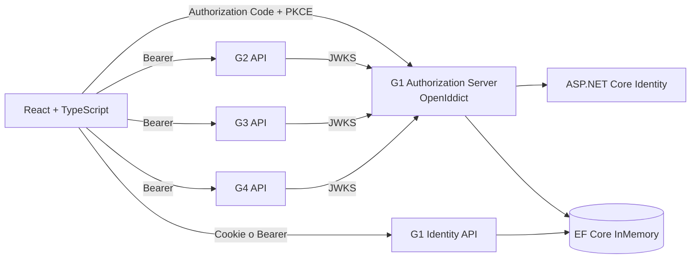

# Feature Specification: Contrato de identidad y mock para G2, G3 y G4

**Feature Branch**: `001-g1-identidad-contrato-mock`

**Created**: 2026-11-11

**Clarified**: 2026-11-24

**Status**: Clarified — ready for plan (fase A); decisiones de fase B abiertas

**Input**: El usuario solicita el primer entregable de G1: contrato OpenAPI y mock de identidad para desbloquear a G2, G3 y G4, sin generar todavía el servidor OAuth real ni modificar la constitución.

## 1. Propósito y contexto

G1 es el propietario único de la identidad, la autenticación, las sesiones, los roles y la matriz base de permisos. G2, G3 y G4 no pueden implementar login, usuarios ni autorización propia; deben consumir un contrato estable de G1.

El primer entregable no es el servidor OAuth real. Es el **contrato de identidad versionado y un mock fiel** que permita a los otros módulos:

- Conocer la forma exacta de la sesión, el `userId`, los roles, los permisos y los errores.
- Desarrollar y probar sus flujos sin esperar a la integración real.
- Sustituir el mock por el servidor real sin cambiar su código de negocio, solo la configuración del proveedor de identidad.

La arquitectura objetivo —servidor OAuth 2.0/OIDC propio con ASP.NET Core Identity y OpenIddict— se documenta en este repositorio, pero su implementación pertenece a una especificación posterior. Las decisiones que aún no están ratificadas se registran en el apartado 8 y en el registro de decisiones pendientes.

### 1.1 Resultado esperado

Al finalizar esta especificación debe existir:

1. Un contrato OpenAPI 3.1 versionado, legible y navegable en Swagger UI.
2. Un mock de identidad ejecutable que implemente el contrato y reproduzca el flujo Authorization Code + PKCE con personas ficticias.
3. Una guía para consumidores con ejemplos de configuración, audiencia, scopes, validación de tokens, roles, permisos y errores.
4. Pruebas de contrato y E2E que impidan que el mock se desvíe del contrato.

### 1.2 Fases de entrega

| Fase | Contenido | Estado |
| --- | --- | --- |
| A. Contrato y mock | Esta especificación | Clarificada; lista para plan |
| B. Servidor real | Identity + OpenIddict + InMemory, registro, login, tokens, sesiones y revocación | Especificación posterior |
| C. Integración real | Sustitución del mock, permisos verificados y E2E de G2/G3/G4 | Especificación posterior |

## Clarifications

### Session 2026-11-24

- Q: ¿Qué información de autorización debe devolver `/me` para que G2, G3 y G4 puedan decidir permisos sin duplicar reglas de identidad? → A: Opción A: `/me` devuelve `roles` y `permissions`; G1 publica códigos estables y cada módulo resuelve sus ámbitos (equipo, categoría, colectivo) con `userId` y sus propios datos. El catálogo mínimo se versiona y se amplía sin romper consumidores.
- Q: ¿Cómo debe exponer G1 el correo o teléfono de socios y familias que G4 necesita para comunicaciones, sin romper la minimización? → A: Solo autoservicio vía userinfo: G1 no expone datos de contacto de terceros; `/connect/userinfo` devuelve únicamente los datos del usuario autenticado y G4 obtiene los contactos de G3, que los gestiona en la ficha de socio.

## 2. Alcance

### 2.1 Incluido

- El contrato OpenAPI 3.1 de la API de identidad que consumen G2, G3 y G4.
- La superficie OIDC/OAuth 2.0 observable que necesitan los clientes: descubrimiento, JWKS, autorización, token, userinfo, revocación y logout.
- El mock de identidad con personas ficticias, tokens de desarrollo y escenarios de error reproducibles.
- Swagger UI para explorar y probar el contrato en desarrollo.
- Pruebas de contrato con xUnit y pruebas E2E con Playwright.
- La guía de consumo, el registro de cambios y la política de versionado del contrato.
- La documentación de limitaciones, decisiones pendientes y riesgos.

### 2.2 Excluido

- La implementación del servidor OAuth real, el registro real de usuarios, el almacenamiento de contraseñas y la emisión real de tokens.
- La introspección de tokens (`/connect/introspect`) y cualquier mecanismo de revocación inmediata de access tokens JWT.
- La interfaz de administración de usuarios, roles y permisos.
- El envío real de correo o SMS, la verificación de teléfono y el segundo factor.
- La recuperación de contraseña y el cambio de contraseña reales.
- Cualquier dato o endpoint de negocio de G2, G3 o G4.
- La exposición de datos de contacto de terceros: G1 no actúa como directorio; G4 los obtiene de G3.
- El despliegue en producción, la gestión real de claves y el endurecimiento de infraestructura.
- La modificación de la constitución o de sus restricciones técnicas.
- Cualquier atajo de autorización en el mock que pueda confundirse con una vía válida en producción.

### 2.3 Fuera de alcance de la fase A, pero diseñado para no bloquear la fase B

- El mock debe usar el mismo contrato y los mismos códigos de error que el servidor real.
- El contrato debe admitir tanto sesión por cookie (BFF) como token Bearer, para no cerrar la decisión pendiente D-001.
- El contrato debe incluir `sessionId` y el claim `sid` para que la revocación de sesiones sea implementable en la fase B.
- El contrato debe incluir la versión y la política de cambios incompatibles desde el primer día.
- El contrato debe poder añadir introspección en una versión posterior sin romper a los consumidores, pero no la publica en v1.
- El mock no decide D-001, D-012 ni D-016: cookies y Bearer son modos configurables, el comportamiento de consentimiento se declara como simulación temporal sin cerrar la decisión y la audiencia `identity-api` queda marcada como provisional.

## 3. Escenarios de usuario y pruebas

### US1 — Contrato publicado y navegable (P1)

Como desarrollador de G2, G3 o G4, quiero consultar el contrato OpenAPI y probarlo en Swagger UI para generar clientes y conocer las formas exactas de respuesta y error.

**Por qué tiene prioridad**: sin contrato no hay integración posible y cada módulo inventaría su propia autenticación.

**Prueba independiente**: se puede verificar arrancando el mock y recorriendo el contrato sin implementar ningún módulo consumidor.

**Escenarios de aceptación**:

1. **Dado** el repositorio recién clonado, **cuando** ejecuto el comando documentado, **entonces** el mock arranca y Swagger UI carga en `/swagger` con el documento OpenAPI 3.1.
2. **Dado** el documento OpenAPI, **cuando** inspecciono `/api/v1/identity/me`, **entonces** encuentro seguridad, esquema de respuesta, ejemplos y todos los errores documentados.
3. **Dado** un cambio en el contrato, **cuando** se ejecuta la validación de CI, **entonces** el pipeline detecta cambios incompatibles y exige una nueva versión o una nota de migración.
4. **Dado** el mock, **cuando** invoco una operación desde Swagger UI con una persona de prueba, **entonces** obtengo la respuesta documentada.

### US2 — Sesión simulada mediante Authorization Code + PKCE (P1)

Como desarrollador consumidor, quiero obtener una sesión del mock usando el mismo flujo OIDC que usará producción, para que mi integración sea fiel desde el principio.

**Por qué tiene prioridad**: el flujo de autorización es el contrato más delicado; si el mock usa atajos, la integración real fallará.

**Prueba independiente**: se puede completar el flujo con un cliente de prueba y verificar el token y la llamada a `/me` sin depender de G2, G3 ni G4.

**Escenarios de aceptación**:

1. **Dado** el mock y un cliente de desarrollo registrado, **cuando** inicio `/connect/authorize` con PKCE S256, `state`, `nonce` y scope `openid profile email identity.api`, **entonces** veo un selector de personas o, en desarrollo, puedo indicar `mock_persona`, y recibo un código en la URI de redirección registrada.
2. **Dado** un código válido y su `code_verifier`, **cuando** llamo a `/connect/token`, **entonces** recibo `access_token`, `id_token`, `refresh_token` cuando se solicitó `offline_access`, `token_type`, `expires_in` y `scope`.
3. **Dado** un `code_verifier` incorrecto o un código ya usado, **cuando** intento canjearlo, **entonces** recibo `invalid_grant` y ningún token.
4. **Dado** el token de acceso, **cuando** llamo a `/api/v1/identity/me`, **entonces** recibo `userId`, `roles`, `permissions`, `sessionId`, `authenticatedAt` y `expiresAt`.
5. **Dado** el token de identidad, **cuando** valido emisor, audiencia `client_id`, firma con JWKS y `nonce`, **entonces** la validación es correcta; el access token se valida con `aud=identity-api`.
6. **Dado** un refresh token válido, **cuando** lo canjeo, **entonces** recibo un nuevo access token y un refresh token rotado, y el refresh anterior deja de ser aceptado.

### US3 — Autorización por rol y permiso, con errores explícitos (P1)

Como consumidor, quiero distinguir sesión ausente, sesión inválida, permiso insuficiente y recurso no visible para renderizar estados correctos y no filtrar información.

**Por qué tiene prioridad**: la constitución exige denegación por defecto, mínimo privilegio y respuestas explícitas.

**Prueba independiente**: se puede probar con las personas del mock y con los escenarios de token inválido sin implementar la interfaz de un módulo.

**Escenarios de aceptación**:

1. **Dado** que no envío credencial, **cuando** llamo a `/api/v1/identity/me`, **entonces** recibo `401` con `application/problem+json` y código `identity.session.required`.
2. **Dado** un token caducado, revocado o con firma inválida, **cuando** llamo a `/me`, **entonces** recibo `401` con `identity.session.invalid` y sin detalles internos.
3. **Dado** un usuario autenticado sin el permiso requerido, **cuando** consulta un resumen de usuario restringido, **entonces** recibo `403` con `identity.permission.denied`.
4. **Dado** un `userId` inexistente o no visible, **cuando** consulto su resumen, **entonces** recibo `404` con `identity.user.not_found`, sin revelar si existe.
5. **Dado** un cuerpo inválido, **cuando** llamo a un endpoint que lo acepta, **entonces** recibo `400` con errores por campo y un código estable.
6. **Dado** una petición válida, **cuando** el usuario tiene permiso, **entonces** recibo `200` con el esquema documentado.

### US4 — Logout y revocación de sesiones (P2)

Como usuario, quiero cerrar mi sesión actual y revocar otras sesiones abiertas para limitar el impacto de un dispositivo perdido.

**Por qué tiene prioridad**: la constitución exige sesiones revocables y trazabilidad; el contrato debe definir la revocación antes de implementarla.

**Prueba independiente**: se puede probar con dos sesiones de la misma persona en el mock y verificar que una revocación no afecta a la otra cuando no debe.

**Escenarios de aceptación**:

1. **Dado** una sesión activa, **cuando** llamo a `POST /api/v1/identity/logout`, **entonces** recibo `204`, la sesión y sus refresh tokens quedan revocados, y el access token anterior deja de aceptarse como máximo al expirar su TTL (5 min por defecto).
2. **Dado** un usuario con varias sesiones, **cuando** consulto `GET /api/v1/identity/sessions`, **entonces** recibo solo sus sesiones, con `current`, `createdAt`, `lastSeenAt`, `expiresAt`, `clientId` y `deviceLabel`, sin direcciones IP ni secretos.
3. **Dado** otra sesión del mismo usuario, **cuando** llamo a `DELETE /api/v1/identity/sessions/{sessionId}`, **entonces** recibo `204`, esa sesión y sus refresh tokens quedan revocados y no se afecta a la actual.
4. **Dado** varias sesiones, **cuando** llamo a `POST /api/v1/identity/sessions/revoke-all` con `keepCurrentSession=true`, **entonces** se revocan las demás y sus refresh tokens, y la actual sigue activa.
5. **Dado** un `sessionId` de otro usuario, **cuando** intento revocarlo, **entonces** recibo `404`, no `403`, para no permitir enumeración.

### US5 — Personas y casos límite reproducibles (P2)

Como tester o desarrollador, quiero personas ficticias deterministas que cubran los roles y los estados relevantes para probar permisos, errores y accesibilidad.

**Por qué tiene prioridad**: sin fixtures deterministas, cada equipo inventa datos y las pruebas dejan de ser comparables.

**Prueba independiente**: se puede reiniciar el mock y comprobar que las personas, roles y permisos vuelven al estado inicial.

**Escenarios de aceptación**:

1. **Dado** el mock en desarrollo, **cuando** llamo a `POST /api/v1/identity/mock/reset`, **entonces** las personas, sesiones y tokens vuelven al estado base y la operación es idempotente.
2. **Dado** una persona publicada en `GET /api/v1/identity/mock/personas`, **cuando** inicio sesión con ella, **entonces** sus roles y permisos coinciden exactamente con la tabla publicada.
3. **Dado** una persona inactiva o bloqueada, **cuando** intenta autenticarse, **entonces** recibo un `401` genérico, sin revelar el estado de la cuenta.
4. **Dado** una persona con correo no verificado, **cuando** consulta `/me`, **entonces** recibo los permisos limitados documentados para ese estado.
5. **Dado** una persona menor de edad, **cuando** un consumidor consulta su resumen, **entonces** solo recibe los campos permitidos y ningún dato del tutor.
6. **Dado** un token de prueba caducado, revocado, con audiencia incorrecta o con firma inválida, **cuando** llamo a `/me`, **entonces** recibo el error documentado para cada variante.

### US6 — Pruebas de contrato y E2E (P3)

Como responsable de calidad, quiero que el contrato, el mock y el flujo de navegador se validen automáticamente para detectar divergencias antes de que afecten a G2, G3 o G4.

**Por qué tiene prioridad**: un mock que se desvía del contrato es peor que no tener mock, porque crea una falsa confianza.

**Prueba independiente**: se puede ejecutar la suite sin la interfaz de un módulo consumidor.

**Escenarios de aceptación**:

1. **Dado** el contrato OpenAPI, **cuando** se ejecutan las pruebas de contrato, **entonces** cada operación documentada tiene al menos una prueba de éxito y una de error, y las respuestas validan contra su esquema.
2. **Dado** el flujo de navegador, **cuando** Playwright recorre autorización, PKCE, `/me`, logout y revocación, **entonces** el flujo pasa en Chromium y en al menos otro navegador en la ejecución programada.
3. **Dado** un cambio incompatible en el contrato, **cuando** se ejecuta CI, **entonces** el pipeline falla y solicita versión nueva o plan de migración.
4. **Dado** el selector de personas del mock, **cuando** se prueba solo con teclado y con un lector de pantalla básico, **entonces** cumple los criterios de accesibilidad definidos.

## 4. Casos límite

- Token de acceso caducado por unos segundos; se admite una tolerancia de reloj documentada y se rechaza fuera de ella.
- Código de autorización reutilizado, caducado o emitido para otro `client_id` o `redirect_uri`.
- `code_verifier` incorrecto, método `plain` o ausencia de `code_challenge`; solo se admite S256.
- `redirect_uri` no registrada, con comodines o con parámetros añadidos; se rechaza por coincidencia exacta.
- `state` o `nonce` ausentes o alterados; se rechaza el flujo.
- Token con `alg=none`, firma inválida, emisor incorrecto, audiencia incorrecta o `kid` desconocido.
- Usuario desactivado, bloqueado o con el correo sin verificar entre la emisión del token y la petición.
- Rol retirado mientras el token sigue vigente; se define una ventana máxima de vigencia de permisos.
- Sesión revocada mientras el token de acceso sigue vigente; se define una ventana de propagación.
- Revocación concurrente de la misma sesión o del mismo token; la operación es idempotente y no revela si ya estaba revocada.
- `revoke-all` ejecutado desde la sesión actual; no debe cerrar la sesión actual si `keepCurrentSession=true`.
- Listado de sesiones de otro usuario; se responde `404` para no filtrar existencia.
- Lote de resúmenes con más de 100 identificadores, identificadores duplicados o formato inválido.
- Usuario eliminado o anonimizado; se define tombstone o `404` antes de implementar el flujo.
- CORS desde un origen no permitido, preflight rechazado y credenciales no enviadas con comodín.
- Límite de peticiones superado; `429` con `Retry-After` y sin filtrar el estado de la cuenta.
- Cuerpo demasiado grande, tipo de contenido no soportado o `Accept` incompatible.
- Reinicio del mock o de InMemory; las sesiones y tokens se pierden y los fixtures se vuelven a sembrar.
- Reset del mock durante una prueba concurrente; las pruebas deben aislarse por colección o por instancia.
- Persona menor que cumple 18 años o tutor que deja de serlo; fuera de la fase A, pero el modelo no debe impedir resolverlo.

## 5. Requisitos

### 5.1 Requisitos funcionales del contrato y del mock

#### Contrato y documentación

- **FR-001**: El proyecto DEBE publicar un contrato OpenAPI 3.1 versionado en `/openapi/v1.json`, con `operationId` estables, etiquetas, ejemplos, esquemas de seguridad y errores.
- **FR-002**: El contrato DEBE poder explorarse en Swagger UI en `/swagger` en desarrollo y pruebas; en producción la UI DEBE estar deshabilitada por defecto.
- **FR-003**: Todos los endpoints de negocio DEBEN usar el prefijo `/api/v1/identity`; un cambio incompatible DEBE publicarse como `/api/v2` con nota de migración y periodo de compatibilidad.
- **FR-004**: El contrato DEBE declarar los esquemas de seguridad `cookieAuth` y `bearerAuth`, indicando que cada despliegue activa uno y que el mock admite ambos para pruebas.
- **FR-005**: El contrato DEBE incluir ejemplos de éxito y de error para cada operación, con datos ficticios y sin secretos.
- **FR-006**: El contrato DEBE documentar la versión, la fecha de revisión, el propietario y la política de cambios incompatibles.

#### Identidad del usuario autenticado

- **FR-007**: `GET /api/v1/identity/me` DEBE devolver `userId`, `displayName`, `email`, `emailVerified`, `phoneVerified`, `roles`, `permissions`, `sessionId`, `authenticatedAt`, `expiresAt` y `authenticationMethods`.
- **FR-008**: `userId` DEBE ser un identificador opaco, estable y no secuencial; los consumidores DEBEN almacenarlo como referencia y no interpretarlo.
- **FR-009**: `roles` DEBE contener códigos estables del catálogo de roles; `permissions` DEBE contener los permisos efectivos del usuario, no la matriz completa. G1 NO DEBE interpretar ámbitos de negocio: cada módulo consumidor resuelve su ámbito (equipo, categoría, colectivo) con el `userId` y sus propios datos. G1 PUEDE transportar una referencia de ámbito opaca, pero no la valida como regla del módulo. El catálogo de códigos DEBE estar versionado y DEBE poder ampliarse sin romper a los consumidores.
- **FR-010**: `/me` DEBE devolver solo el correo del propio usuario y nunca datos de otro usuario.
- **FR-011**: `/me` DEBE aceptar cookie de sesión o token Bearer según el modo configurado; la respuesta DEBE ser la misma en ambos casos.
- **FR-012**: `/me` DEBE incluir cabecera `Cache-Control: no-store` y no DEBE cachearse en intermediarios.

#### Consulta de otros usuarios

- **FR-013**: `GET /api/v1/identity/users/{userId}/summary` DEBE devolver `userId`, `displayName`, `roles` y `active`, y DEBE excluir correo, teléfono y cualquier dato sensible.
- **FR-014**: El resumen DEBE requerir autenticación y el permiso `identity.users.summary.read` o el permiso de módulo que se ratifique; sin él DEBE devolver `403`.
- **FR-015**: Un `userId` inexistente o no visible DEBE devolver `404` con `identity.user.not_found`, sin distinguir ambos casos en la respuesta.
- **FR-016**: `POST /api/v1/identity/users/lookup` DEBE resolver hasta 100 identificadores por petición, deduplicar, devolver `users` y `missing`, y rechazar lotes mayores con `400`.
- **FR-017**: El resumen de un menor DEBE aplicar minimización adicional y no DEBE incluir datos del tutor ni información de salud.

#### Sesiones, logout y revocación

- **FR-018**: `GET /api/v1/identity/sessions` DEBE listar solo las sesiones del usuario autenticado, con `sessionId`, `current`, `createdAt`, `lastSeenAt`, `expiresAt`, `clientId` y `deviceLabel`.
- **FR-019**: `DELETE /api/v1/identity/sessions/{sessionId}` DEBE revocar una sesión propia y sus refresh tokens y devolver `204`; una sesión ajena o inexistente DEBE devolver `404`.
- **FR-020**: `POST /api/v1/identity/sessions/revoke-all` DEBE revocar todas las sesiones del usuario y sus refresh tokens, y aceptar `keepCurrentSession`; la operación DEBE ser idempotente. Los access tokens ya emitidos siguen válidos hasta su expiración.
- **FR-021**: `POST /api/v1/identity/logout` DEBE revocar la sesión actual y sus refresh tokens y devolver `204`; los access tokens ya emitidos siguen válidos hasta su expiración. El cliente DEBE poder continuar con el logout OIDC RP-initiated.
- **FR-022**: La revocación de sesiones y refresh tokens DEBE ser efectiva en el almacén de G1 en la siguiente validación y DEBE probarse. La revocación de un access token JWT NO DEBE prometerse antes de su expiración salvo que exista un mecanismo verificable; su ventana máxima de exposición es su TTL, 5 minutos por defecto. La caducidad del access token y la revocación de sesión/refresh DEBEN documentarse y probarse por separado.
- **FR-023**: Las operaciones de revocación DEBEN registrar un evento de auditoría con actor, objetivo, resultado y marca temporal, sin secretos ni datos personales innecesarios.
- **FR-024**: El contrato DEBE documentar el endpoint OIDC de fin de sesión, los parámetros `id_token_hint`, `post_logout_redirect_uri` y `state`, y la coincidencia exacta de la URI de retorno.

#### Catálogo de roles y permisos

- **FR-025**: `GET /api/v1/identity/catalog/roles` DEBE publicar los códigos de rol, su etiqueta en castellano, su descripción y si son asignables.
- **FR-026**: `GET /api/v1/identity/catalog/permissions` DEBE publicar los códigos de permiso, su etiqueta, su módulo propietario y su descripción.
- **FR-027**: Los códigos de rol y permiso DEBEN ser estables y en inglés; las etiquetas y descripciones DEBEN estar en castellano.
- **FR-028**: Los consumidores DEBEN tratar los códigos desconocidos como no concedidos y no DEBEN fallar por la aparición de un permiso nuevo.

#### Mock de identidad

- **FR-029**: El mock DEBE implementar descubrimiento OIDC, JWKS, autorización, token, userinfo, revocación y logout con el mismo contrato que el servidor real.
- **FR-030**: El mock DEBE admitir únicamente Authorization Code con PKCE S256; DEBE rechazar implicit flow, password grant, `code_challenge_method=plain` y cualquier concesión no prevista.
- **FR-031**: El mock DEBE ofrecer un selector de personas accesible y, solo en desarrollo, el parámetro `mock_persona` para automatización.
- **FR-032**: El mock DEBE publicar `GET /api/v1/identity/mock/personas` con al menos las personas y estados del apartado 5.5.
- **FR-033**: El mock DEBE ofrecer `POST /api/v1/identity/mock/reset` para restaurar fixtures, sesiones y tokens; DEBE estar deshabilitado fuera de desarrollo y pruebas. En v1 NO usa token de reset: solo está disponible en `Development`/`Testing` y devuelve `404` en otros entornos.
- **FR-034**: El mock DEBE emitir tokens JWT firmados con una clave de desarrollo. El access token DEBE incluir `iss`, `aud=identity-api` (provisional), `sub`, `exp`, `iat`, `nbf`, `jti`, `sid`, roles, permisos y estado de verificación; el ID token DEBE incluir `aud=client_id`, `sub`, `nonce`, `auth_time` y `sid`, según OIDC. La distinción de audiencia DEBE documentarse y probarse por tipo de token.
- **FR-035**: El mock DEBE permitir simular token caducado, revocado, con audiencia incorrecta y con firma inválida, sin crear una vía de autorización alternativa.
- **FR-036**: El mock NO DEBE exponer una vía de emisión de tokens fuera de `/connect/token`, ni contraseñas fijas en el código, ni secretos reales; la selección de persona en desarrollo no sustituye al canje de código con PKCE.
- **FR-037**: El mock DEBE ser sustituible por el servidor real cambiando la configuración del emisor, las credenciales del cliente y las claves, sin cambios en el código de negocio del consumidor.

#### Errores, seguridad y operación

- **FR-038**: Los errores de la API de identidad DEBEN usar `application/problem+json` con `type`, `title`, `status`, `detail`, `instance`, `code` y `traceId`.
- **FR-039**: Los errores OAuth DEBEN usar el formato estándar `error`, `error_description`, `error_uri` y `state`, con códigos estables y sin detalles internos.
- **FR-040**: Ninguna respuesta DEBE incluir trazas, excepciones, secretos, tokens de otros usuarios ni datos personales innecesarios.
- **FR-041**: La API DEBE aplicar límites de peticiones en autorización, token, login del mock, registro futuro y consultas de resumen; al superarlos DEBE devolver `429` con `Retry-After`.
- **FR-042**: La API DEBE aplicar una lista de orígenes CORS por entorno y NO DEBE usar comodín con credenciales.
- **FR-043**: La API DEBE enviar cabeceras de seguridad adecuadas al entorno, incluida `Content-Security-Policy` en la UI de Swagger y `X-Content-Type-Options: nosniff`.
- **FR-044**: Los eventos de autenticación, emisión, revocación, logout y acceso denegado relevante DEBEN quedar auditados con `correlationId`, actor, objetivo, resultado y marca temporal.
- **FR-045**: El mock DEBE rechazar peticiones de escritura sin protección CSRF cuando use cookies, y DEBE documentar el token antiforgery o el patrón BFF elegido.

#### Pruebas y documentación

- **FR-046**: Cada operación documentada DEBE tener al menos una prueba de contrato de éxito y una de error, y las respuestas DEBEN validarse contra el esquema OpenAPI.
- **FR-047**: El flujo Authorization Code + PKCE, refresco rotativo, `/me`, logout y revocación de sesión/refresh DEBE cubrirse con una prueba E2E de Playwright.
- **FR-048**: CI DEBE detectar cambios incompatibles en el contrato y fallar si no hay versión nueva o nota de migración.
- **FR-049**: La guía de consumo DEBE explicar configuración OIDC, PKCE, validación de tokens, roles, permisos, errores, fixtures y sustitución del mock por el servidor real.
- **FR-050**: README y CHANGELOG DEBEN actualizarse cuando cambie el contrato, el mock o las instrucciones de ejecución.
- **FR-051**: La documentación DEBE indicar qué está simulado, qué falta para la integración real y qué decisiones siguen pendientes.
- **FR-052**: Los datos de ejemplo DEBEN ser ficticios, estar en castellano cuando sean funcionales y no contener datos personales reales.

#### Audiencia, introspección y catálogo provisional

- **FR-053**: El contrato DEBE declarar la audiencia provisional `identity-api` y los scopes `openid`, `profile`, `email`, `offline_access` e `identity.api`. Cada API consumidora DEBE validar la audiencia y aplicar sus propias políticas de autorización; un token con audiencia `identity-api` NO DEBE aceptarse automáticamente en las APIs de G2, G3 o G4. La decisión de audiencias definitivas se registra como D-016.
- **FR-054**: El contrato v1 NO DEBE publicar `/connect/introspect` ni el mock DEBE implementarlo. La validación JWT con JWKS NO garantiza revocación inmediata; la introspección podrá añadirse en una versión posterior.
- **FR-055**: El mock DEBE implementar el grant `refresh_token` con rotación y revocación, y DEBE distinguir en su documentación entre la revocación de sesión/refresh y la expiración de los access tokens.
- **FR-056**: Las respuestas de `/api/v1/identity/catalog/roles` y `/catalog/permissions` DEBEN incluir `catalogVersion` y `provisional: true` mientras el catálogo v1 no se ratifique. Un cambio de código estable DEBE seguir la política de versionado y no romper a los consumidores.
- **FR-057**: El contrato v1 NO DEBE exponer el correo, el teléfono ni otros datos de contacto de terceros. `/connect/userinfo` DEBE devolver solo los datos del usuario autenticado: `sub`, `name`, `email` y `email_verified` cuando se conceda el scope `email`. El teléfono no se publica en v1 porque no existe scope `phone`. G4 DEBE obtener los contactos de G3, propietario de la ficha de socio; G1 no actúa como directorio de contacto.
- **FR-058**: Cualquier ampliación futura de datos de contacto DEBE exigir permiso explícito, minimización, auditoría y consentimiento vigente para menores. No se implementa en la fase A.

### 5.2 Requisitos no funcionales

- **NFR-001**: Un desarrollador DEBE poder pasar de un clon a una llamada exitosa a `/me` en 15 minutos o menos siguiendo la guía.
- **NFR-002**: El mock DEBE responder a `/me` con una latencia p95 inferior a 200 ms en local, excluyendo el primer arranque.
- **NFR-003**: Los fixtures y las pruebas DEBEN ser deterministas; no DEBEN depender del reloj real, del orden de ejecución ni de estado compartido entre pruebas.
- **NFR-004**: El mock NO DEBE contener secretos reales, datos personales reales ni claves privadas comprometidas en el repositorio.
- **NFR-005**: El selector de personas y las páginas del mock DEBEN cumplir WCAG 2.1 AA en los flujos principales: teclado, foco visible, etiquetas, contraste y errores comprensibles.
- **NFR-006**: La documentación y los textos de interfaz DEBEN estar en castellano; los identificadores de código DEBEN estar en inglés.
- **NFR-007**: El contrato DEBE validar contra OpenAPI 3.1 y DEBE poder consumirse con herramientas estándar de generación de clientes.
- **NFR-008**: Las pruebas de contrato DEBEN completarse en menos de 5 minutos y las E2E en menos de 10 minutos en un entorno de CI estándar.
- **NFR-009**: Los logs DEBEN ser estructurados, incluir `correlationId` y no DEBEN contener tokens, contraseñas ni datos personales innecesarios.
- **NFR-010**: El mock DEBE funcionar en Linux y Windows con el SDK .NET 10.0.404 y Node.js LTS.

### 5.3 Restricciones técnicas confirmadas

Estas restricciones provienen de la constitución y del mandato del usuario; no son decisiones libres de la fase A.

- .NET 10.0 y C# 14 con ASP.NET Core Minimal APIs.
- React + TypeScript para la interfaz web, con build y despliegue independientes.
- OpenAPI + Swagger UI.
- Entity Framework Core InMemory para la persistencia académica, con `DisableBulkOperations()` y las limitaciones del ADR-0002. ADR-0002 sigue pendiente de ratificación formal: esta especificación no autoriza a ejecutar la implementación hasta que se ratifique.
- xUnit para backend y Playwright para navegador.
- Servidor OAuth 2.0/OIDC propio, sin proveedores externos, cuando se implemente la fase B.
- ASP.NET Core Identity para usuarios y contraseñas, y OpenIddict para OAuth 2.0/OIDC, cuando se implemente la fase B.
- Authorization Code + PKCE; prohibidos implicit flow y password grant.
- Sin criptografía manual ni servidor OAuth casero.

La verificación de versiones y la evidencia de compatibilidad se documentan en `docs/g1/diagnostico-tecnico.md`. La decisión de arquitectura se registra en `docs/decisions/ADR-0001-servidor-oauth-propio-identity-openiddict.md` y la excepción de persistencia en `docs/decisions/ADR-0002-inmemory-persistencia-academica.md`.

### 5.4 Entidades clave

- **Identidad de usuario**: persona única en el club; `userId` opaco, nombre visible, correo, teléfono, estado de verificación, estado activo y marcas de creación y actualización. No contiene datos de negocio de otros módulos.
- **Rol**: agrupación estable de permisos con código, etiqueta, descripción y si es asignable. No contiene reglas de ámbito de negocio. El catálogo v1 provisional se define en 5.5 y queda pendiente de validación del equipo.
- **Permiso**: autorización atómica con código estable, módulo propietario y descripción. La matriz v1 provisional se define en 5.5; los permisos de G2, G3 y G4 los publican sus propietarios y G1 los incorpora al catálogo sin reinterpretarlos.
- **Asignación de rol**: vínculo entre identidad y rol, con quién la concede, a quién, cuándo y motivo. Es auditable y revocable. Si el módulo propietario necesita ámbito, G1 transporta una referencia opaca sin interpretarla; el módulo resuelve el ámbito con `userId` y sus propios datos.
- **Sesión**: periodo de autenticación con `sessionId`, usuario, cliente, fechas de creación, último uso y expiración, estado y métodos de autenticación. Se identifica con el claim `sid`.
- **Aplicación cliente**: cliente OAuth registrado con `clientId`, tipo público o confidencial, URIs de redirección y de logout, permisos, requisitos y tipo de consentimiento.
- **Autorización o consentimiento**: concesión de un cliente para un usuario y unos ámbitos; puede ser implícita para módulos de primera parte o explícita para terceros.
- **Token**: artefacto de acceso, identidad o refresco con emisor, audiencia, sujeto, sesión, expiración, estado y referencia. No se almacena en claro cuando no corresponde.
- **Evento de auditoría**: registro de un evento de identidad con actor, objetivo, tipo, resultado, correlación y marca temporal, sin secretos.
- **Persona de prueba**: fixture del mock con clave estable, identidad ficticia, roles, permisos, estado y etiquetas de caso. Solo existe en desarrollo y pruebas.
- **Error de contrato**: problema RFC 9457 con código estable, mensaje para la interfaz y campos afectados cuando sea seguro.

### 5.5 Superficie del contrato

#### Protocolo OIDC/OAuth

| Método | Ruta | Autenticación | Propósito | Éxito | Errores principales |
| --- | --- | --- | --- | --- | --- |
| GET | `/.well-known/openid-configuration` | Ninguna | Descubrimiento OIDC | 200 | 500 |
| GET | `/.well-known/jwks.json` | Ninguna | Claves públicas de firma | 200 | 500 |
| GET | `/connect/authorize` | Sesión o selector de persona | Authorization Code + PKCE | 302 | 400, 401, 403 |
| POST | `/connect/token` | `client_id` y secreto si es confidencial | Canje de código y refresco | 200 | 400, 401, 429 |
| GET | `/connect/userinfo` | Bearer | Claims OIDC del usuario | 200 | 401 |
| POST | `/connect/revoke` | `client_id` y secreto si es confidencial | Revocación de token | 200 | 400, 401 |
| GET, POST | `/connect/logout` | Sesión o `id_token_hint` | Fin de sesión OIDC | 302, 204 | 400 |

`/connect/introspect` no forma parte de v1. La introspección podrá añadirse de forma aditiva en una versión posterior si se ratifica D-005 para producción. La validación JWT con JWKS no aporta revocación inmediata: un access token sigue siendo aceptado hasta su `exp`.

#### API de identidad

| Método | Ruta | Autenticación | Propósito | Éxito | Errores principales |
| --- | --- | --- | --- | --- | --- |
| GET | `/api/v1/identity/me` | Cookie o Bearer | Identidad y permisos efectivos | 200 | 401, 429, 500 |
| GET | `/api/v1/identity/users/{userId}/summary` | Cookie o Bearer + permiso | Resumen mínimo de otro usuario | 200 | 401, 403, 404 |
| POST | `/api/v1/identity/users/lookup` | Cookie o Bearer + permiso | Resumen por lote | 200 | 400, 401, 403 |
| GET | `/api/v1/identity/sessions` | Cookie o Bearer | Sesiones propias | 200 | 401 |
| DELETE | `/api/v1/identity/sessions/{sessionId}` | Cookie o Bearer | Revocar sesión propia | 204 | 401, 404 |
| POST | `/api/v1/identity/sessions/revoke-all` | Cookie o Bearer | Revocar otras sesiones | 200, 204 | 401 |
| POST | `/api/v1/identity/logout` | Cookie o Bearer | Cerrar sesión actual | 204 | 401 |
| GET | `/api/v1/identity/catalog/roles` | Cookie o Bearer | Catálogo de roles | 200 | 401 |
| GET | `/api/v1/identity/catalog/permissions` | Cookie o Bearer | Catálogo de permisos | 200 | 401 |

No se publica ningún endpoint de contacto de terceros en v1. `/connect/userinfo` solo devuelve los datos del usuario autenticado y G4 obtiene los contactos de G3 (FR-057).

#### Solo para desarrollo y pruebas

| Método | Ruta | Autenticación | Propósito | Éxito | Errores principales |
| --- | --- | --- | --- | --- | --- |
| GET | `/api/v1/identity/mock/personas` | Ninguna en `Development`/`Testing` | Personas y estados disponibles | 200 | 404 en otros entornos |
| POST | `/api/v1/identity/mock/reset` | Ninguna en `Development`/`Testing` | Restaurar fixtures | 204 | 404 en otros entornos |

#### Fixtures mínimos del mock

El conjunto normativo contiene **15 personas ficticias** y **4 casos de token** (`token.expired`, `token.revoked`, `token.wrong-audience`, `token.invalid-signature`). Las claves `token.*` no son personas: son escenarios reproducibles que se emiten únicamente a través de `/connect/token`.

| Clave | Rol principal | Estado | Caso que cubre |
| --- | --- | --- | --- |
| `admin.club` | `club_admin` | Activo, verificado | Acceso total de G1 |
| `sports.manager` | `sports_manager` | Activo, verificado | Gestión deportiva de G2 |
| `coach.ana` | `coach` | Activo, verificado | Ámbito restringido de entrenador |
| `player.minor` | `player` | Activo, verificado, menor | Minimización de datos de menores |
| `member.active` | `member` | Activo, verificado | Socio al día |
| `member.phone-unverified` | `member` | Activo, correo verificado, teléfono sin verificar | Verificación de teléfono pendiente |
| `tutor.familiar` | `tutor` | Activo, verificado | Tutor o familiar |
| `sponsor.acme` | `sponsor` | Activo, verificado | Patrocinador; sin acceso a datos de otros usuarios |
| `supporter.fan` | `supporter` | Activo, verificado | Simpatizante; sin permisos de identidad |
| `kit.staff` | `kit_staff` | Activo, verificado | Material y equipaciones de G4 |
| `comms.staff` | `communications_staff` | Activo, verificado | Comunicaciones de G4 |
| `user.no-role` | Ninguno | Activo, verificado | Usuario sin permisos; estado vacío |
| `user.unverified` | `member` | Activo, correo sin verificar | Permisos limitados y verificación pendiente |
| `user.inactive` | `member` | Inactivo | Cuenta desactivada; error genérico |
| `user.locked` | `member` | Bloqueado | Bloqueo temporal; error genérico |
| `token.expired` | `coach` | Token caducado | Error de sesión inválida |
| `token.revoked` | `coach` | Token revocado | Revocación simulada en el mock; no representa revocación inmediata en producción |
| `token.wrong-audience` | `coach` | Token con audiencia incorrecta | Validación de audiencia |
| `token.invalid-signature` | `coach` | Firma inválida | Validación de firma |

Las claves y los permisos exactos se publican en `GET /api/v1/identity/mock/personas` y en la guía de consumo. La tabla de fixtures es normativa en cuanto a los casos cubiertos. Los estados de negocio de G3, como una cuota pendiente, no se simulan en la identidad: pertenecen a los fixtures de G3.

#### Catálogo provisional v1 de roles

El catálogo es **provisional y está pendiente de validación del equipo**. Los códigos son estables y en inglés; las etiquetas, en castellano. `club_admin`, `coach`, `player`, `tutor`, `member`, `sponsor` y `supporter` cubren los siete perfiles exigidos; `sports_manager`, `kit_staff` y `communications_staff` son roles operativos ya presentes en los fixtures.

| Código | Etiqueta | Asignable | Descripción |
| --- | --- | --- | --- |
| `club_admin` | Administrador del club | Sí | Administración de identidad y configuración de G1. |
| `sports_manager` | Gestor deportivo | Sí | Coordinación deportiva; sus permisos de G2 los define G2. |
| `coach` | Entrenador | Sí | Entrenador de equipo o categoría. |
| `player` | Deportista | Sí | Deportista, incluido menor de edad. |
| `tutor` | Familia o tutor | Sí | Tutor legal o familiar de un deportista. |
| `member` | Socio | Sí | Socio del club. |
| `sponsor` | Patrocinador | Sí | Patrocinador del club. |
| `supporter` | Simpatizante | Sí | Simpatizante sin permisos de identidad. |
| `kit_staff` | Personal de material | Sí | Equipaciones y material, coordinado con G4. |
| `communications_staff` | Personal de comunicación | Sí | Comunicaciones, coordinado con G4. |

#### Permisos v1 propiedad de G1

Solo se publican los permisos que G1 posee y puede evaluar. Los permisos de G2, G3 y G4 no se inventan aquí: cada módulo los publicará y G1 los incorporará al catálogo cuando se ratifiquen. Los endpoints de autoprotección (`/me`, `/sessions`, `/logout` y catálogos) requieren autenticación, no un permiso adicional.

| Código | Etiqueta | Módulo propietario | Descripción |
| --- | --- | --- | --- |
| `identity.users.summary.read` | Leer resumen de usuarios | G1 | Consultar `/api/v1/identity/users/{userId}/summary`. |
| `identity.users.lookup` | Resolver usuarios por lote | G1 | Consultar `/api/v1/identity/users/lookup`. |
| `identity.admin` | Administrar identidad | G1 | Reservado para operaciones administrativas futuras; no habilita endpoints de fase A. |

#### Matriz rol-permiso v1 (deny-by-default)

| Rol | `identity.users.summary.read` | `identity.users.lookup` | `identity.admin` |
| --- | --- | --- | --- |
| `club_admin` | Sí | Sí | Sí |
| `sports_manager` | Sí | Sí | No |
| `coach` | No | No | No |
| `player` | No | No | No |
| `tutor` | No | No | No |
| `member` | No | No | No |
| `sponsor` | No | No | No |
| `supporter` | No | No | No |
| `kit_staff` | No | No | No |
| `communications_staff` | No | Sí | No |

Cualquier permiso no concedido explícitamente se deniega. El ámbito de los permisos (por ejemplo, qué deportistas puede consultar un entrenador) NO lo resuelve G1: el módulo propietario lo resuelve con el `userId` y sus propios datos, según la respuesta A de la clarificación de 2026-11-24. La fase A no aplica ámbitos de módulo. Las respuestas de catálogo DEBEN marcarse con `catalogVersion` y `provisional: true`.

### 5.6 Convenciones del contrato

- **Formato**: JSON UTF-8; errores con `application/problem+json`; fechas ISO 8601 en UTC con sufijo `Z`.
- **Identificadores**: opacos, con prefijo legible (`usr_`, `ses_`, `rol_`, `prm_`), sin significado secuencial.
- **Nombres**: campos funcionales en castellano cuando representan datos del dominio; rutas y códigos estables en inglés.
- **Paginación**: `page` y `pageSize` con máximo 100 para listados; respuesta con `items`, `page`, `pageSize` y `total`.
- **Correlación**: se acepta y devuelve `X-Correlation-ID`; los errores incluyen `traceId`.
- **Caché**: las respuestas de identidad usan `Cache-Control: no-store`; los catálogos pueden cachearse con `ETag` y validación.
- **Idempotencia**: logout, revocación y reset son idempotentes; repetir la operación no cambia el resultado observable.
- **Versionado**: cambios aditivos dentro de `v1`; cambios incompatibles requieren `v2`, nota de migración y periodo de convivencia.
- **Compatibilidad**: los consumidores deben ignorar campos desconocidos y tratar códigos desconocidos como no concedidos.
- **Audiencia y scopes (provisional)**: el access token de G1 usa `aud=identity-api` y el ID token usa `aud=client_id`; los scopes son `openid`, `profile`, `email`, `offline_access` e `identity.api`. `identity.api` autoriza la API de identidad de G1, no las APIs de G2, G3 o G4. Cada API consumidora DEBE validar `aud` y aplicar su propia política de autorización; la aceptación de `identity-api` por otros módulos queda pendiente de D-016. Los scopes no sustituyen a los permisos: la autorización fina se resuelve con la matriz de permisos.
- **Catálogos**: las respuestas de roles y permisos incluyen `catalogVersion` y `provisional`; un código desconocido se trata como no concedido.

### 5.7 Modelo de errores

Los errores de la API siguen RFC 9457. Ejemplo orientativo:

```json
{
  "type": "https://identity.example.test/errors/session-required",
  "title": "Sesión requerida",
  "status": 401,
  "detail": "Debes iniciar sesión para acceder a este recurso.",
  "instance": "/api/v1/identity/me",
  "code": "identity.session.required",
  "traceId": "00-4bf92f3577b34da6a3ce929d0e0e4736-00f067aa0ba902b7-01"
}
```

Códigos estables mínimos:

| Código | HTTP | Significado |
| --- | --- | --- |
| `identity.session.required` | 401 | No se ha enviado credencial |
| `identity.session.invalid` | 401 | Credencial caducada, revocada o inválida |
| `identity.permission.denied` | 403 | Identidad válida sin permiso suficiente |
| `identity.user.not_found` | 404 | Usuario inexistente o no visible |
| `identity.request.invalid` | 400 | Cuerpo, parámetros o cabeceras inválidos |
| `identity.rate_limited` | 429 | Límite de peticiones superado |
| `identity.internal_error` | 500 | Error no expuesto al cliente |

Los errores OAuth usan los códigos estándar (`invalid_request`, `invalid_client`, `invalid_grant`, `unauthorized_client`, `unsupported_grant_type`, `invalid_scope`, `access_denied`, `server_error`, `temporarily_unavailable`) y no reutilizan los códigos de la API de negocio.

### 5.8 Reglas de seguridad del contrato

- La autenticación se basa en Authorization Code + PKCE S256; no se admiten implicit flow, password grant, `client_credentials` para identidad de usuario ni tokens emitidos por una vía alternativa.
- La validación de tokens en los módulos comprueba firma con JWKS, emisor, audiencia, `exp`, `nbf`, `jti` cuando corresponda y ámbito; nunca confía en un `userId` o rol enviado por el cliente.
- La audiencia `identity-api` es provisional y solo identifica la API de G1. Un token de G1 NO DEBE aceptarse en G2, G3 o G4 por el mero hecho de estar firmado; cada API valida `aud` y sus propios scopes y permisos. La decisión de audiencias definitivas es D-016.
- Los permisos efectivos se calculan en el servidor; el cliente no puede elevar privilegios modificando el token, la interfaz o un parámetro.
- Las cookies, si se adoptan, son `HttpOnly`, `Secure`, `SameSite=Lax` o más estricta y con prefijo `__Host-`; las escrituras requieren antiforgery.
- Los access tokens son de corta duración (5 minutos por defecto). La revocación de sesión y refresh tokens es efectiva en G1 en la siguiente validación; un access token JWT sigue siendo aceptado hasta su `exp` salvo que exista un mecanismo verificable. No se promete revocación inmediata del JWT en 30 segundos.
- No se publica `/connect/introspect` en v1. La validación JWKS no aporta revocación inmediata; la introspección podrá añadirse en una versión posterior si se ratifica para producción.
- Los secretos y las claves privadas no se comprometen al repositorio; las claves de desarrollo son efímeras y las de producción se gestionan fuera.
- Los logs y las respuestas no incluyen tokens, contraseñas, datos de salud, datos de menores ni datos personales innecesarios.
- Los datos de menores y de salud se minimizan y se filtran antes de salir de G1.

#### Parámetros de tiempo del mock (configurables)

| Parámetro | Valor por defecto | Nota |
| --- | --- | --- |
| Código de autorización | 5 min | Un solo uso, ligado a `client_id` y `redirect_uri`. |
| Access token | 5 min | Válido hasta `exp`; la revocación de sesión no lo invalida retroactivamente. |
| ID token | 5 min | Validación de `nonce`, emisor y audiencia. |
| Refresh token | 8 h, rotativo | Cada canje rota y revoca el anterior; no supera la duración absoluta de la sesión. |
| Inactividad de sesión | 30 min | Renovable con actividad autenticada. |
| Duración absoluta de sesión | 12 h | No renovable. |
| Tolerancia de reloj | 2 min máximo | Aplicada a `exp`, `nbf` e `iat`. |

Estos valores son configurables por entorno y se usan en desarrollo y pruebas. La revocación de sesión y refresh se mide en G1; la caducidad del access token se mide por su TTL. No se declara una ventana de revocación de access tokens JWT inferior al TTL sin un mecanismo verificable.

### 5.9 Arquitectura objetivo de la fase B

La fase A no implementa el servidor real, pero el contrato debe ser compatible con esta arquitectura:



La aceptación de tokens emitidos para `identity-api` por parte de G2, G3 o G4 no está decidida y se registra en D-016. Hasta entonces, cada API debe validar la audiencia y rechazar la que no le corresponda.

Flujos que la fase B deberá implementar y probar:

- **Registro**: correo y teléfono obligatorios, verificación, política de contraseñas, consentimiento y tratamiento de menores según las decisiones pendientes.
- **Login**: página interactiva de G1 o BFF; Identity valida credenciales y bloqueo; OpenIddict emite código; nunca se expone un endpoint de password grant.
- **Emisión**: canje de código con PKCE, token de acceso, token de identidad y refresh rotativo; claves asimétricas y JWKS.
- **Validación**: los módulos validan JWT localmente con JWKS; comprueban emisor, audiencia, firma, expiración y permisos. La introspección no forma parte de v1 y no se presupone revocación inmediata de access tokens.
- **Roles y permisos**: catálogo provisional v1, matriz explícita, denegación por defecto, asignación auditada y permisos efectivos en el token o resolubles en G1. G1 no interpreta ámbitos de negocio: cada módulo resuelve su ámbito (equipo, categoría, colectivo) con el `userId` y sus propios datos. El catálogo está versionado y se amplía de forma aditiva sin romper a los consumidores.
- **Sesiones**: `sid` en los tokens, registro de sesión, expiración por inactividad y absoluta, listado y revocación.
- **Logout y revocación**: fin de sesión OIDC, revocación de sesión y refresh tokens; los access tokens expiran por TTL. La revocación inmediata de access tokens queda pendiente de D-005.
- **Refresco**: rotación, detección de reutilización y revocación de la familia.
- **Datos de contacto**: G1 solo expone el contacto del usuario autenticado en `/me` y `/connect/userinfo` (scope `email`). No hay directorio de contacto ni endpoint de contacto de terceros; G4 obtiene los contactos de G3 y cualquier ampliación futura exige permiso, auditoría y consentimiento de tutor para menores (FR-057, FR-058).
- **Audiencias**: definir la matriz definitiva de audiencias por API antes de la integración (D-016).
- **2FA**: TOTP y códigos de recuperación como opción; métodos y obligatoriedad pendientes.

Los detalles de versión, compatibilidad y limitaciones están en `docs/g1/diagnostico-tecnico.md`.

## 6. Criterios de éxito

### 6.1 Resultados medibles

- **SC-001**: Un desarrollador de G2, G3 o G4 completa la guía y obtiene una respuesta `200` de `/me` en 15 minutos o menos.
- **SC-002**: El 100 % de las operaciones documentadas tiene al menos una prueba de contrato de éxito y una de error, y CI está en verde.
- **SC-003**: Cambiar del mock al servidor real no requiere cambios en el código de negocio del consumidor; solo configuración de emisor, cliente y claves. Se verifica con una prueba de humo.
- **SC-004**: El 100 % de los fallos de autenticación y autorización probados devuelve el código y el esquema documentados; ninguna respuesta contiene trazas, secretos ni datos personales innecesarios.
- **SC-005**: El flujo Playwright de autorización, PKCE, `/me`, logout y revocación pasa en Chromium en cada PR y en al menos otro navegador en la ejecución programada.
- **SC-006**: El documento OpenAPI valida contra OpenAPI 3.1 y no presenta cambios incompatibles sin versión nueva o nota de migración.
- **SC-007**: La latencia p95 de `/me` en local es inferior a 200 ms.
- **SC-008**: El selector de personas del mock pasa las comprobaciones automáticas de accesibilidad y se puede usar solo con teclado.
- **SC-009**: El escaneo de secretos no encuentra claves privadas, contraseñas ni tokens reales en el repositorio.
- **SC-010**: La revocación de una sesión o refresh token se refleja en la siguiente validación de G1; el access token emitido deja de aceptarse como máximo al expirar su TTL (5 min por defecto). La prueba mide ambos plazos por separado y no exige revocación inmediata del JWT.
- **SC-011**: El contrato declara `aud=identity-api` para el access token, `aud=client_id` para el ID token y los scopes acordados; una API consumidora que no tenga una decisión de audiencia explícita rechaza el access token. La comprobación se documenta en la guía y se cubre con una prueba de configuración.
- **SC-012**: Ninguna respuesta de G1 expone correo, teléfono ni datos de contacto de terceros; `/connect/userinfo` solo devuelve los datos del usuario autenticado. Se cubre con una prueba de contrato que confirma que no existe endpoint de contacto ajeno y que userinfo ignora cualquier identificador de otro usuario.

### 6.2 Métodos de validación

- Pruebas de contrato con xUnit contra el mock y validación de esquemas.
- Pruebas E2E con Playwright para el flujo de navegador.
- Validación del documento OpenAPI con una herramienta estándar y comparación de cambios.
- Revisión manual de la guía de consumo por un consumidor de otro módulo.
- Escaneo de secretos y revisión de logs de ejemplo.
- Prueba de sustitución del mock por una configuración de emisor distinta.
- Prueba de audiencia: un access token con `aud=identity-api` se acepta en G1 y se rechaza en una configuración de consumidor que no declare esa audiencia; el ID token se valida con `aud=client_id`.
- Comprobación de que `/connect/introspect` no está publicado en v1 ni en el mock.
- Comprobación de que no existe endpoint de contacto de terceros y de que `/connect/userinfo` solo devuelve los datos del usuario autenticado.
- Medición separada de la revocación de sesión/refresh y de la expiración del access token por TTL.

## 7. Supuestos

- El club es único; no hay multi-tenancy en el alcance inicial.
- Los consumidores usan bibliotecas OIDC estándar y no implementan criptografía propia.
- El mock se ejecuta solo en desarrollo y pruebas; nunca se expone en producción.
- Los datos de las personas son ficticios y no representan personas reales.
- El entorno de desarrollo dispone de .NET SDK 10.0.404, Node.js LTS y acceso a NuGet y npm.
- La fase B se especificará antes de implementarse; esta especificación no autoriza a escribir el servidor real.
- La constitución sigue vigente y cualquier excepción de persistencia requiere ratificación.
- El contrato puede evolucionar; los cambios incompatibles siguen la política de versionado.
- La audiencia `identity-api` es provisional y no autoriza por sí misma el acceso a G2, G3 o G4; la matriz definitiva es D-016.
- En v1 no se garantiza la revocación inmediata de access tokens JWT; se garantiza la revocación de sesión/refresh y la expiración del access token por TTL.
- Las decisiones pendientes del apartado 8 no se resuelven implícitamente en el mock.

## 8. Decisiones pendientes

Las decisiones se registran también en `docs/decisions/pending-decisions.md`. Las decisiones cerradas para la fase A se indican en la tabla; las abiertas no se resuelven por defecto en código.

| ID | Decisión | Por qué importa | Recomendación | Bloquea |
| --- | --- | --- | --- | --- |
| D-001 | BFF con cookies o SPA pública con tokens | Cambia el transporte, CSRF, CORS y el almacenamiento de tokens | BFF con cookies `HttpOnly` para el cliente web; el contrato admite ambos | Fase B |
| D-002 | Catálogo provisional v1 de roles y matriz de permisos | Define los códigos, la autorización real y los fixtures | Aprobado para fase A: catálogo de 10 roles, incluidos `sponsor` y `supporter`, matriz deny-by-default; pendiente de validación del equipo | Ratificación en fase B |
| D-003 | Ámbitos de rol y propiedad de los ámbitos | G2 posee equipos; G1 no debe duplicar reglas de G2 | Resuelta (2026-11-24, respuesta A): G1 emite roles y permisos; cada módulo resuelve su ámbito con `userId` y sus propios datos; catálogo versionado y ampliable | Fase C (verificación con G2) |
| D-004 | Duración de tokens, refresco, rotación y ventana de revocación | Afecta a seguridad, UX y propagación de revocación | Valores de desarrollo/pruebas aprobados: código 5 min, access 5 min, id 5 min, refresh rotativo 8 h, inactividad 30 min, absoluta 12 h, skew 2 min; producción pendiente de ratificar | Fase B (valores de producción) |
| D-005 | Revocación por JWT corto, introspección o denylist | Un JWT es válido hasta expirar aunque se revoque la sesión | Sin introspección en v1; JWT corto + revocación de sesión/refresh; la revocación inmediata de access tokens sigue abierta para producción | Producción |
| D-006 | 2FA: métodos, obligatoriedad y step-up | Afecta a login, soporte y accesibilidad | TOTP + códigos de recuperación; obligatorio para administradores | Fase B |
| D-007 | Registro, política de contraseñas, verificación y menores | Afecta a RGPD, UX y datos sensibles | Correo y teléfono obligatorios; verificación; consentimiento de tutor para menores | Fase B |
| D-008 | Retención y acceso a auditoría | La auditoría contiene datos personales | Retención mínima necesaria, acceso restringido y anonimización | Fase B |
| D-009 | Persistencia definitiva y migración desde InMemory | InMemory no cumple migraciones ni producción | SQLite o SQL Server/PostgreSQL antes de datos reales; ver ADR-0002 | Producción |
| D-010 | Proveedores de correo y SMS | Necesarios para verificación y recuperación | Encapsular y elegir proveedor antes de la fase B | Fase B |
| D-011 | Alojamiento, TLS, gestión de claves y key ring | Sin claves persistentes las sesiones se invalidan al reiniciar | Gestionar claves fuera del repositorio y persistir el key ring | Producción |
| D-012 | Consentimiento de módulos de primera parte | Afecta a UX y al modelo de autorización | Abierta. El mock solo declara un modo de simulación configurable y NO decide el comportamiento de producción | Fase B |
| D-013 | Eliminación y anonimización de cuentas | RGPD y auditoría | Definir tombstone, anonimización y conservación mínima | Fase B |
| D-014 | Política de deprecación de versiones | Los módulos necesitan tiempo de migración | Ventana mínima de un semestre o la duración del curso | Fase B |
| D-015 | Multi-club o multi-tenancy | Cambia el modelo de identidad y los ámbitos | Fuera de alcance inicial; no diseñar para múltiples clubes sin requisito | Futuro |
| D-016 | Audiencias definitivas por API | Un token para `identity-api` no debe aceptarse por defecto en G2/G3/G4 | Decidir la matriz de audiencias antes de la integración; validar `aud` en cada API | Fase B e integración G2/G3/G4 |
| D-017 | Fuente de los datos de contacto para comunicaciones de G4 | G4 necesita correo o teléfono, pero G1 no debe convertirse en directorio | Resuelta (2026-11-24): G1 solo expone el contacto propio vía `/me` y userinfo; G4 obtiene los contactos de G3 | Fase C (contrato G3-G4) |

D-002, D-003, D-004, D-005 y D-017 quedan cerradas para la fase A en el alcance indicado. D-001 y D-016 siguen abiertas y no bloquean el plan de la fase A; D-004 y D-005 mantienen abiertos sus valores y mecanismos de producción, la verificación de D-003 con G2 corresponde a la fase C y D-017 depende del contrato de contacto de G3.

## 9. Dependencias y riesgos

### 9.1 Dependencias

- Aprobación de esta especificación. ADR-0002 bloquea la implementación de la fase A hasta su ratificación formal. ADR-0001 bloquea la arquitectura de la fase B, pero no impide el mock de fase A con OpenIddict como motor temporal.
- Ratificación de D-001, D-004 (valores de producción), D-005 (revocación de access tokens) y D-016 (audiencias) antes de la fase B; D-002 y D-003 quedan aprobadas para la fase A, con la verificación de ámbitos de D-003 en la fase C.
- Disponibilidad de .NET SDK 10.0.404 y de los paquetes verificados.
- Coordinación con G2, G3 y G4 para la validación del catálogo provisional y la matriz de audiencias.
- Coordinación con G3 para el contrato de datos de contacto que consume G4 (D-017).
- Definición de la matriz de permisos por parte de G1 con los propietarios de módulo.
- Entorno de CI con Node.js LTS para Playwright.

### 9.2 Riesgos

| Riesgo | Impacto | Mitigación |
| --- | --- | --- |
| El mock se desvía del servidor real | Integraciones falsas y retrabajo | Contrato único, pruebas de contrato y prueba de sustitución |
| Los consumidores copian permisos o roles del mock | Autorización frágil | Catálogo versionado y revisión de código |
| InMemory oculta errores relacionales | Fallos al cambiar a una base real | Modelo agnóstico de proveedor y prueba de CI con proveedor relacional |
| La revocación no es inmediata con JWT | Ventana de acceso tras logout | Access token de 5 min; revocación de sesión/refresh; documentar que el JWT sigue válido hasta `exp`; evaluar denylist o introspección para producción |
| Un módulo acepta por error la audiencia `identity-api` | Acceso cruzado no autorizado | Validación obligatoria de `aud`, revisión de configuración y decisión D-016 antes de integración |
| OpenIddict 8.0 es preview | Riesgo de adoptar una versión inestable | Usar 7.8.0 estable y revisar la migración cuando haya versión estable |
| El contrato crece sin gobierno | Rupturas y clientes rotos | Versionado, diff de OpenAPI y revisión de consumidores |
| Datos de menores o salud se filtran | Incumplimiento RGPD y daño | Minimización, permisos específicos y pruebas de denegación |
| El mock se expone por error | Bypass de autorización | Deshabilitado fuera de desarrollo, comprobación de entorno y escaneo de configuración |
| La UI de Swagger se publica en producción | Divulgación de superficie de API | Deshabilitada por defecto y revisión de configuración |
| El equipo no ratifica las decisiones | Bloqueo de la fase B | Registro de decisiones con responsable y fecha objetivo |

## 10. Fuera de alcance

- Implementación del servidor OAuth real y de ASP.NET Core Identity para usuarios reales en esta fase. El mock usa OpenIddict y EF Core InMemory como motor académico temporal, sin usuarios reales ni persistencia de producción.
- Interfaz de administración de usuarios, roles y permisos.
- Registro, recuperación de contraseña, verificación de correo o teléfono y 2FA reales.
- Endpoints de negocio de G2, G3 y G4.
- Introspección de tokens y revocación inmediata de access tokens JWT en v1.
- Producción, alta disponibilidad, copias de seguridad y recuperación.
- Modificación de la constitución o de las restricciones técnicas.
- Uso de proveedores de identidad externos.
- Implementación manual de criptografía o de un servidor OAuth casero.

## 11. Trazabilidad

| Requisito | Escenario | Validación |
| --- | --- | --- |
| FR-001 a FR-006 | US1 | Validación OpenAPI, Swagger UI y diff de contrato |
| FR-007 a FR-012 | US2, US3 | Pruebas de contrato de `/me` y E2E de sesión |
| FR-013 a FR-017 | US3 | Pruebas de resumen, lote y denegación |
| FR-018 a FR-024 | US4 | Pruebas de sesiones, logout, revocación de sesión/refresh y expiración de access token |
| FR-025 a FR-028 | US3 | Pruebas de catálogo, matriz provisional y tolerancia a códigos desconocidos |
| FR-029 a FR-037 | US2, US5 | Pruebas del mock, PKCE, refresco y fixtures |
| FR-038 a FR-045 | US3, US4 | Pruebas de errores, CORS, rate limit y auditoría |
| FR-046 a FR-052 | US6 | CI, Playwright y revisión de documentación |
| FR-053 a FR-058 | US2, US3, US5 | Pruebas de audiencia, ausencia de introspección, refresco, catálogo provisional y ausencia de contacto de terceros |
| NFR-001 a NFR-010 | Todos | Medición, revisión y CI |
| SC-001 a SC-012 | Todos | Criterios de aceptación medibles |

## 12. Glosario

- **Authorization Code + PKCE**: flujo OAuth 2.0 en el que el cliente obtiene un código y lo canjea con un verificador de prueba; obligatorio en esta solución.
- **Audiencia**: valor `aud` de un token que identifica la destinataria; en v1 es `identity-api` de forma provisional en el access token y `client_id` en el ID token.
- **BFF**: backend for frontend; capa de servidor que mantiene los tokens fuera del navegador y usa cookies de sesión.
- **Claim**: afirmación incluida en un token, como `sub`, `sid`, rol o permiso.
- **InMemory**: proveedor de EF Core que guarda datos en memoria y los pierde al reiniciar; solo para desarrollo, demostración y pruebas.
- **Introspection**: consulta al emisor para saber si un token es válido y qué permite; no forma parte de v1 y podría añadirse en una versión posterior.
- **JWKS**: conjunto de claves públicas usado para validar la firma de los JWT.
- **JWT**: token firmado con claims; no se implementa criptografía manual.
- **OIDC**: capa de identidad sobre OAuth 2.0; aporta descubrimiento, `id_token`, userinfo y logout.
- **OpenIddict**: biblioteca .NET mantenida para servidor y validación OAuth 2.0/OIDC.
- **Persona**: fixture ficticia del mock con roles, permisos y estado deterministas.
- **Problem Details**: formato RFC 9457 para errores de API.
- **Refresh token**: credencial de larga duración que permite renovar el access token; en v1 es rotativo y revocable.
- **Revocación**: invalidación de una sesión o refresh token antes de su expiración natural; un access token JWT no se invalida retroactivamente sin un mecanismo verificable.
- **Scope**: ámbito OAuth que limita lo que un cliente puede solicitar.
- **Sesión**: periodo autenticado identificado por `sid`, con expiración y revocación.
- **SPA**: aplicación de página única en React + TypeScript.
- **Token de acceso**: credencial de corta duración para llamar a una API.
- **Token de identidad**: JWT OIDC con claims de identidad para el cliente.

## 13. Clarificaciones (2026-11-22 y 2026-11-24)

| # | Pregunta | Decisión ratificada |
| --- | --- | --- |
| 1 | Catálogo de roles y matriz de permisos (D-002) | Opción A de la clarificación (catálogo completo de perfiles). Catálogo provisional v1 con los siete perfiles exigidos, incluidos `sponsor` y `supporter`, más los roles operativos de los fixtures. Códigos estables, matriz explícita y denegación por defecto. Pendiente de validación del equipo. |
| 2 | Audiencia y scopes OAuth | Opción A de la clarificación, provisional. `aud=identity-api`; scopes `openid`, `profile`, `email`, `offline_access` e `identity.api`. Cada API consumidora valida la audiencia y aplica su propia política; un token de `identity-api` no es válido automáticamente para G2, G3 o G4. La decisión definitiva es D-016. |
| 3 | Introspección (D-005) | Opción B de la clarificación (sin introspección). `/connect/introspect` no se incluye en el contrato v1 ni en el mock. Podrá añadirse en una versión posterior. La validación JWT con JWKS no garantiza revocación inmediata. |
| 4 | Vigencias y revocación (D-004) | Opción A de la clarificación (valores configurables). Código 5 min, access token 5 min, ID token 5 min, refresh rotativo 8 h, inactividad 30 min, duración absoluta 12 h, tolerancia de reloj 2 min. La revocación de sesión/refresh se prueba por separado de la caducidad del access token; no se promete revocación de JWT en 30 segundos. |
| 5 | Modelo de autorización y ámbitos (D-003) | Opción A de la clarificación (2026-11-24). `/me` devuelve `roles` y `permissions`; G1 publica códigos estables y cada módulo resuelve sus ámbitos (equipo, categoría, colectivo) con el `userId` y sus propios datos. G1 no interpreta ámbitos de negocio. El catálogo está versionado y se amplía sin romper a los consumidores. |
| 6 | Contacto para G4 (D-017) | Opción C de la clarificación (2026-11-24). Solo autoservicio vía userinfo: G1 no expone datos de contacto de terceros y `/connect/userinfo` solo devuelve los datos del usuario autenticado. G4 obtiene los contactos de G3, que los gestiona en la ficha de socio. Cualquier ampliación futura exige permiso, auditoría y consentimiento de tutor para menores. |
